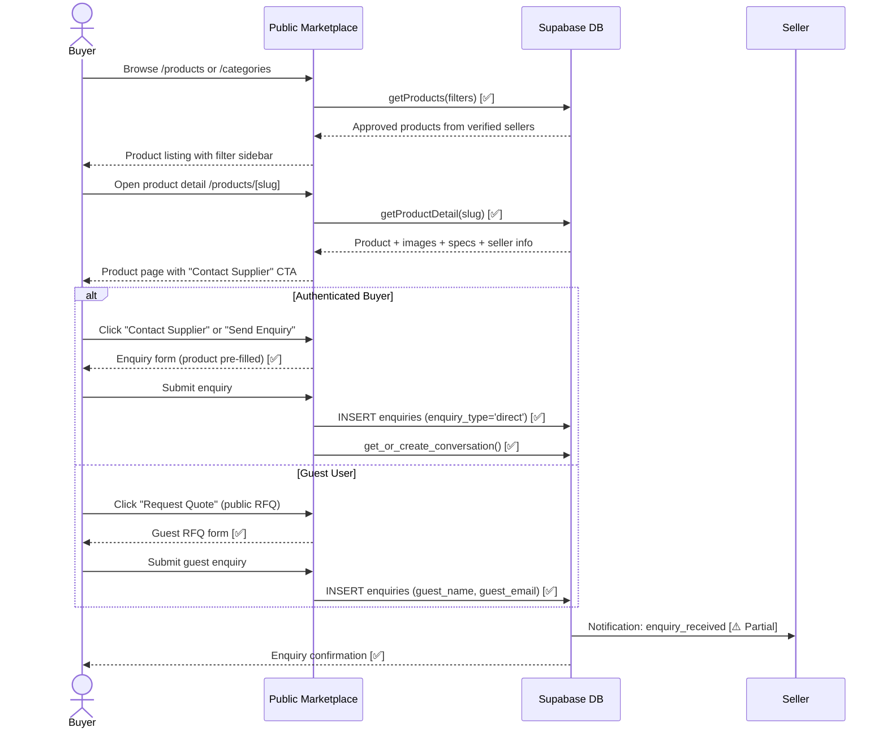
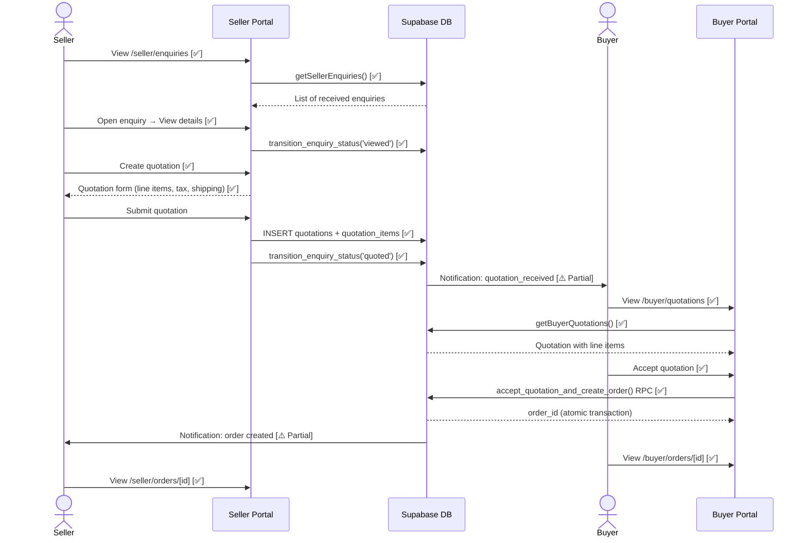
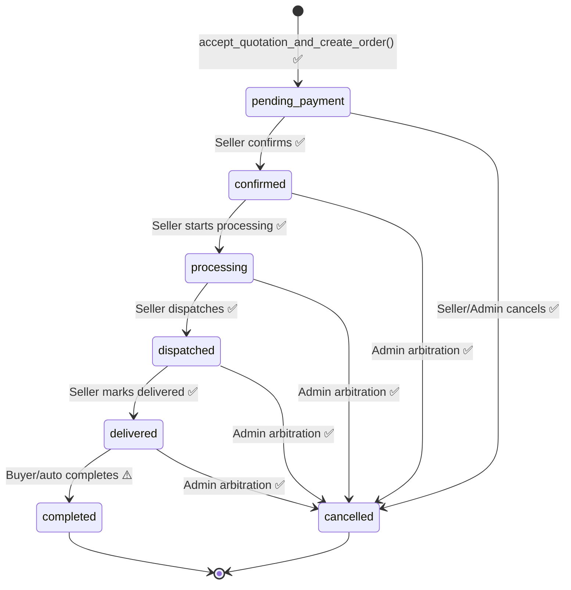
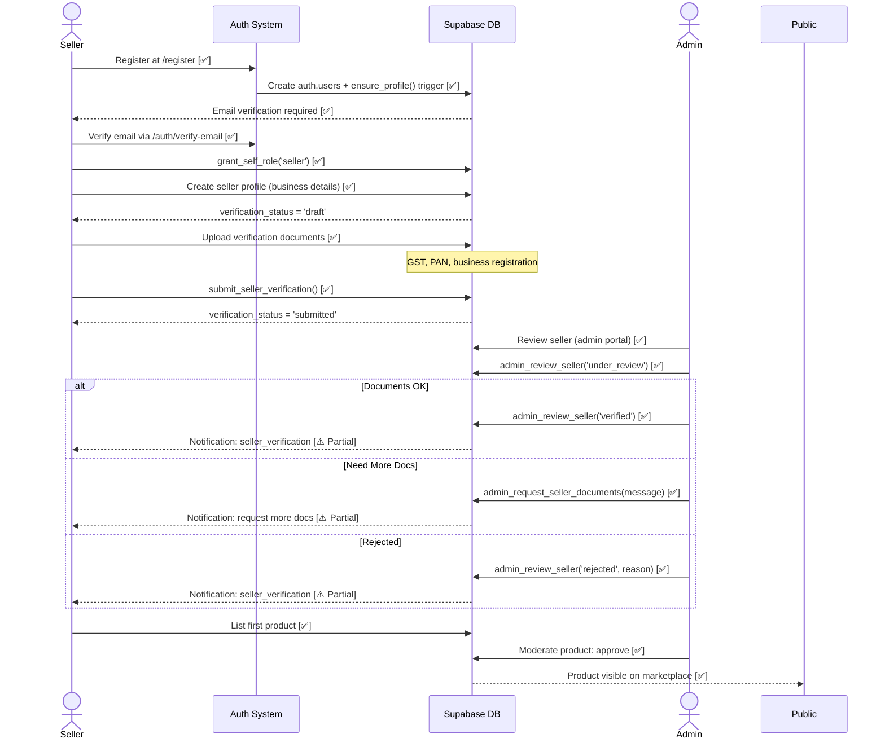
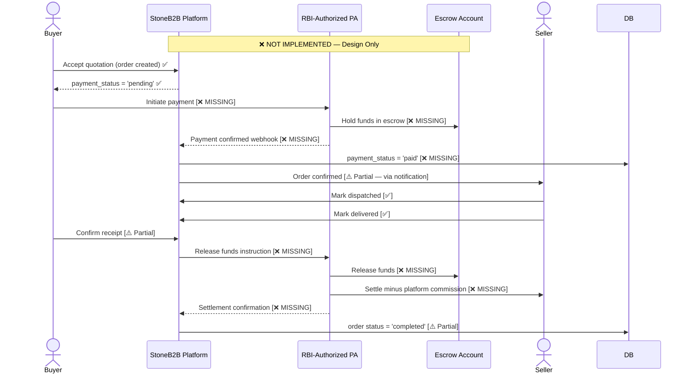
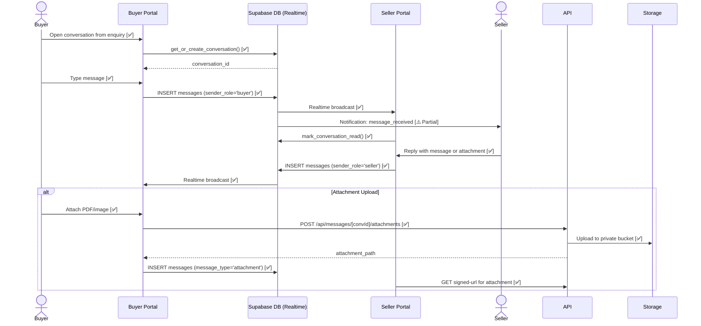
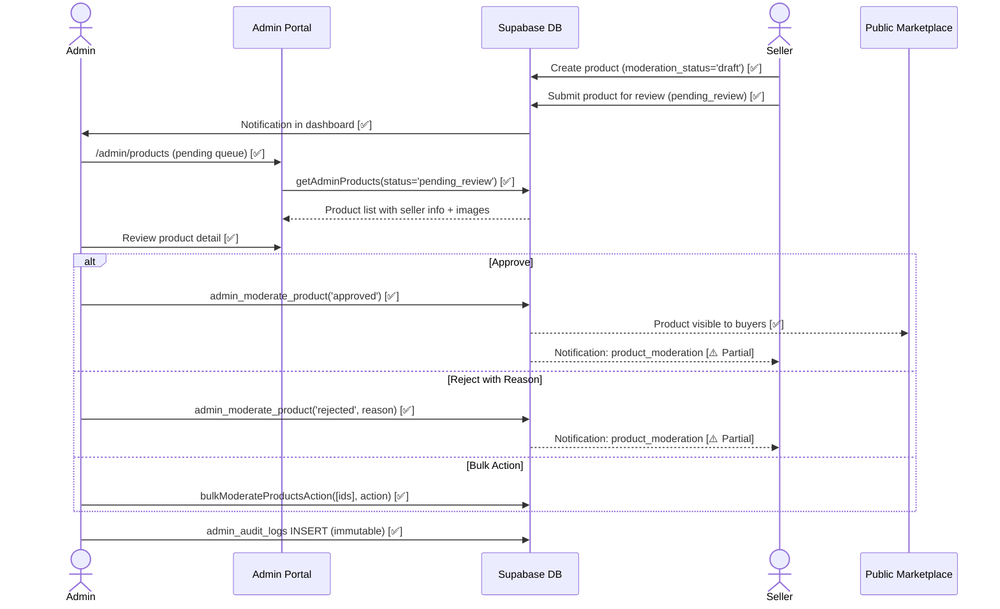

# StoneB2B — Business Workflows
**Classification:** Read-Only Architecture Audit  
**Date:** 2026-11-11

---

## Overview

This document maps the five core end-to-end business workflows of the StoneB2B platform against actual implemented code. Each step is classified as:
- ✅ **IMPLEMENTED** — Code found and functional
- ⚠️ **PARTIAL** — Step partially handled or incomplete
- ❌ **MISSING** — Step not implemented

---

## Workflow A: Buyer → Product Discovery → Enquiry

### A. Workflow Steps Detail

| Step | Route/Action | Status | Gap |
|------|-------------|--------|-----|
| Browse product catalogue | `GET /products` → `getProducts()` | ✅ IMPLEMENTED | — |
| Filter (material, colour, finish, origin, price, sort) | URL params → `ProductFilterParams` | ✅ IMPLEMENTED | — |
| Full-text search | `textSearch()` on `search_vector` | ✅ IMPLEMENTED | — |
| View product detail | `GET /products/[slug]` → `getProductDetail()` | ✅ IMPLEMENTED | — |
| Browse supplier directory | `GET /suppliers` → `getPublicSellers()` | ✅ IMPLEMENTED | — |
| View supplier storefront | `GET /suppliers/[slug]` | ✅ IMPLEMENTED | — |
| Submit direct enquiry (authenticated) | `enquiry/actions.ts` → `enquiries` INSERT | ✅ IMPLEMENTED | — |
| Submit guest RFQ (public) | `rfq/public-rfq-actions.ts` | ✅ IMPLEMENTED | — |
| Idempotency guard | `client_request_id` unique constraint | ✅ IMPLEMENTED | — |
| Notify seller via notification | `notifications` table INSERT | ⚠️ PARTIAL | Trigger not confirmed in source |
| Email seller | Worker email | ⚠️ PARTIAL | Job queue missing |
| Auto-match RFQ to multiple sellers | Supplier matching engine | ❌ MISSING | Not implemented |
| Save product to favourites | `favourites/actions.ts` | ✅ IMPLEMENTED | — |

---

## Workflow B: Seller → Quotation → Order Creation

### B. Workflow Steps Detail

| Step | Route/Action | Status | Gap |
|------|-------------|--------|-----|
| Seller views enquiry list | `seller/enquiries/` → `getSellerEnquiries()` | ✅ IMPLEMENTED | — |
| Mark enquiry as viewed | `transition_enquiry_status('viewed')` | ✅ IMPLEMENTED | — |
| Seller creates quotation | `createQuotationAction()` | ✅ IMPLEMENTED | — |
| Multi-line quotation items | `quotation_items` table | ✅ IMPLEMENTED | — |
| Tax, discount, shipping calculation | Server-side `computeQuotationTotals()` | ✅ IMPLEMENTED | — |
| Quote number generation | DB-generated | ✅ IMPLEMENTED | — |
| Buyer views quotation | `buyer/quotations/` | ✅ IMPLEMENTED | — |
| Buyer downloads PDF quote | `GET /api/buyer/quotes/[id]/pdf` | ✅ IMPLEMENTED | — |
| Buyer accepts quotation | `acceptQuotationAction()` → `accept_quotation_and_create_order()` | ✅ IMPLEMENTED | — |
| Order created atomically | RPC wraps quotation update + order insert | ✅ IMPLEMENTED | — |
| Buyer/seller snapshots in order | JSON snapshots at time of order | ✅ IMPLEMENTED | — |
| Notify buyer of quote | `notifications` table | ⚠️ PARTIAL | Trigger not confirmed |
| Counter-offer / negotiation | No counter-offer flow | ❌ MISSING | Not implemented |
| Quotation revision flow | `revised` status exists; no UI flow confirmed | ⚠️ PARTIAL | — |

---

## Workflow C: Order Fulfilment

### C. Workflow Steps Detail

| Step | Route/Action | Status | Gap |
|------|-------------|--------|-----|
| Order created (`pending_payment`) | `accept_quotation_and_create_order()` | ✅ IMPLEMENTED | — |
| Seller confirms order | `transitionOrderStatusAction('confirmed')` | ✅ IMPLEMENTED | — |
| Seller processes order | `transitionOrderStatusAction('processing')` | ✅ IMPLEMENTED | — |
| Seller dispatches | `transitionOrderStatusAction('dispatched')` | ✅ IMPLEMENTED | — |
| Seller marks delivered | `transitionOrderStatusAction('delivered')` | ✅ IMPLEMENTED | — |
| Buyer confirms receipt → completed | `transitionOrderStatusAction('completed')` | ⚠️ PARTIAL | Buyer-initiated completion not confirmed |
| Admin order arbitration | `transitionAdminOrderAction()` — cancel or complete only | ✅ IMPLEMENTED | — |
| Order status history | `order_status_history` table | ✅ IMPLEMENTED | — |
| Payment processing | `payment_status` field exists | ❌ MISSING | No PA integration |
| Auto-escalation on stale orders | — | ❌ MISSING | Not implemented |
| Shipment tracking | — | ❌ MISSING | No logistics API |
| Invoice generation | — | ❌ MISSING | Only quotation PDF |
| Seller settlement | — | ❌ MISSING | No escrow / PA integration |

---

## Workflow D: Seller Onboarding & Verification

### D. Workflow Steps Detail

| Step | Action | Status | Gap |
|------|--------|--------|-----|
| User registration | `/register` → auth signup | ✅ IMPLEMENTED | — |
| Profile auto-creation | `ensure_profile()` trigger | ✅ IMPLEMENTED | — |
| Email verification | `/auth/verify-email` | ✅ IMPLEMENTED | — |
| Self-assign seller role | `grant_self_role('seller')` | ✅ IMPLEMENTED | — |
| Create seller profile | `seller_profiles` INSERT | ✅ IMPLEMENTED | — |
| Upload verification documents | `api/seller/verification/documents` | ✅ IMPLEMENTED | — |
| Submit for verification | `submit_seller_verification()` | ✅ IMPLEMENTED | — |
| Admin reviews + approves | `admin_review_seller()` | ✅ IMPLEMENTED | — |
| Email notifications on status change | Worker email lib | ⚠️ PARTIAL | Queue not confirmed |
| Seller dashboard access | `seller/dashboard/` | ✅ IMPLEMENTED | — |
| List products | `seller/products/` CRUD | ✅ IMPLEMENTED | — |
| Product moderation by admin | `admin_moderate_product()` | ✅ IMPLEMENTED | — |
| Product appears on marketplace | RLS: approved + verified | ✅ IMPLEMENTED | — |
| Subscription gating | No subscription check | ❌ MISSING | Not implemented |

---

## Workflow E: Payment Model B — Governance Architecture

> **Status:** ❌ NOT IMPLEMENTED — This is a governance design document only. The schema has `payment_status` fields but no Payment Aggregator integration code exists.

### E. Payment Model B Gap Analysis

| Component | Status | Priority |
|-----------|--------|---------|
| `payment_status` field on orders | ✅ IMPLEMENTED | — |
| Payment Aggregator selection (Razorpay/PayU/CCAvenue) | ❌ MISSING | 🔴 CRITICAL |
| Payment initiation API | ❌ MISSING | 🔴 CRITICAL |
| Payment webhook handler | ❌ MISSING | 🔴 CRITICAL |
| Escrow / PA integration | ❌ MISSING | 🔴 CRITICAL |
| Fund release to seller | ❌ MISSING | 🔴 CRITICAL |
| Platform commission deduction | ❌ MISSING | 🔴 CRITICAL |
| Payment reconciliation | ❌ MISSING | 🟡 HIGH |
| Refund processing | ❌ MISSING | 🟡 HIGH |
| GST on platform fee | ❌ MISSING | 🟡 HIGH |
| `payment_transactions` table | ❌ MISSING | 🔴 CRITICAL |

---

## Workflow F: Messaging Between Buyer and Seller

---

## Workflow G: Admin Content Moderation

---

## Critical Workflow Gaps Summary

| Workflow | Critical Missing Steps |
|----------|----------------------|
| A — Discovery → Enquiry | Automatic RFQ-to-seller matching; lead distribution; email notification |
| B — Quotation → Order | Counter-offer/negotiation; email notification on quote |
| C — Order Fulfilment | Payment processing; shipment tracking; invoice generation; seller settlement |
| D — Seller Onboarding | Subscription gating on product listing; email notification on verification |
| E — Payment Model B | Entire Payment Aggregator integration; escrow; settlement; reconciliation |
| F — Messaging | Email notification on new messages (worker queue) |
| G — Moderation | Email notification to seller on moderation decision |

