# StoneB2B — Database Architecture
**Classification:** Read-Only Architecture Audit  
**Source:** `packages/database/src/database.types.ts` (1,166 lines)  
**Supabase Project:** `rgmasamasslqintssyrh` (PRODUCTION — inspected read-only)

---

## 1. Complete Entity Inventory

| Table / View | Type | Rows (est.) | Purpose |
|-------------|------|------------|---------|
| `profiles` | Table | Per user | Core user profile — PII |
| `user_roles` | Table | Per user×role | Role assignments (buyer, seller, admin, super_admin) |
| `seller_profiles` | Table | Per seller | Business identity and verification |
| `seller_verification_documents` | Table | Per seller doc | GST, PAN, business registration docs |
| `categories` | Table | ~14 seed | Stone product taxonomy |
| `products` | Table | Per product | Stone product listings |
| `product_images` | Table | Per product image | Storage paths for product photos |
| `product_specifications` | Table | Per product spec | Key-value technical specs |
| `product_favourites` | Table | Per buyer×product | Buyer saved products |
| `enquiries` | Table | Per enquiry | Buyer enquiries and RFQs |
| `enquiry_status_history` | Table | Per transition | Immutable enquiry status audit log |
| `quotations` | Table | Per quotation | Seller quotations on enquiries |
| `quotation_items` | Table | Per line item | Line items in quotation |
| `notifications` | Table | Per notification | In-app notifications |
| `admin_audit_logs` | Table | Per admin action | Immutable admin action log |
| `platform_settings` | Table | 4 keys | Marketplace, contact, homepage, SEO settings |
| `conversations` | Table | Per conversation | Buyer↔Seller messaging thread |
| `messages` | Table | Per message | Individual messages with attachments |
| `buyer_addresses` | Table | Per address | Billing/shipping/project site addresses |
| `orders` | View | Per order | Order view (created from accepted quotation) |
| `order_items` | Table | Per order line | Immutable order line items |
| `order_status_history` | Table | Per transition | Immutable order status audit log |
| `public_seller_profiles` | View | Per verified seller | Public-safe seller data (no PII) |

---

## 2. Entity Relationship Diagram

```mermaid
erDiagram
    profiles {
        uuid id PK
        string full_name
        string email
        string phone
        string avatar_url
        string country
        string state
        string city
        string address
        enum account_status
        timestamp created_at
        timestamp updated_at
    }

    user_roles {
        uuid id PK
        uuid user_id FK
        enum role
        timestamp created_at
    }

    seller_profiles {
        uuid id PK
        uuid user_id FK
        string business_name
        string slug
        enum business_type
        string owner_name
        string business_email
        string phone
        string whatsapp_number
        string gst_number
        string business_address
        string city
        string state
        string country
        enum verification_status
        timestamp verified_at
        timestamp created_at
        timestamp updated_at
    }

    seller_verification_documents {
        uuid id PK
        uuid seller_id FK
        enum document_type
        string storage_path
        enum verification_status
        string rejection_reason
        timestamp uploaded_at
        timestamp reviewed_at
        uuid reviewed_by
    }

    categories {
        uuid id PK
        uuid parent_id FK
        string name
        string slug
        string description
        string image_url
        boolean is_active
        int display_order
        string seo_title
        string seo_description
    }

    products {
        uuid id PK
        uuid seller_id FK
        uuid category_id FK
        string name
        string slug
        string sku
        string description
        string material_type
        string stone_origin
        string colour
        string finish
        int thickness
        int length
        int width
        int minimum_order_quantity
        enum unit
        enum price_type
        decimal price
        string currency
        enum stock_status
        int lead_time
        enum moderation_status
        timestamp published_at
    }

    product_images {
        uuid id PK
        uuid product_id FK
        string storage_path
        string alt_text
        boolean is_primary
        int display_order
    }

    product_specifications {
        uuid id PK
        uuid product_id FK
        string specification_name
        string specification_value
        int display_order
    }

    product_favourites {
        uuid id PK
        uuid buyer_id FK
        uuid product_id FK
        timestamp created_at
    }

    enquiries {
        uuid id PK
        uuid buyer_id FK
        uuid seller_id FK
        uuid product_id FK
        string enquiry_title
        string description
        int quantity
        string unit
        decimal expected_budget
        string currency
        string delivery_location
        date required_delivery_date
        enum status
        string client_request_id
        string guest_name
        string guest_email
        string guest_phone
        string guest_company
        enum enquiry_type
        json specifications
    }

    enquiry_status_history {
        uuid id PK
        uuid enquiry_id FK
        string previous_status
        string new_status
        uuid changed_by
        string notes
        timestamp created_at
    }

    quotations {
        uuid id PK
        uuid enquiry_id FK
        uuid seller_id FK
        uuid buyer_id FK
        string quote_number
        decimal subtotal
        decimal tax_amount
        decimal shipping_charges
        decimal discount_amount
        decimal total_amount
        string currency
        date valid_until
        string terms
        enum status
    }

    quotation_items {
        uuid id PK
        uuid quotation_id FK
        uuid product_id FK
        string description
        int quantity
        string unit
        decimal unit_price
        decimal total_price
    }

    orders {
        uuid id PK
        string order_number
        uuid quotation_id FK
        uuid enquiry_id FK
        uuid buyer_id FK
        uuid seller_id FK
        json buyer_snapshot
        json seller_snapshot
        json billing_address
        json shipping_address
        string delivery_location
        decimal subtotal
        decimal total_amount
        string currency
        enum status
        enum payment_status
        string notes
    }

    order_items {
        uuid id PK
        uuid order_id FK
        uuid product_id FK
        string description
        int quantity
        string unit
        decimal unit_price
        decimal total_price
        json specifications
    }

    order_status_history {
        uuid id PK
        uuid order_id FK
        string previous_status
        string new_status
        uuid changed_by
        string notes
        timestamp created_at
    }

    conversations {
        uuid id PK
        uuid buyer_id FK
        uuid seller_id FK
        uuid enquiry_id FK
        uuid product_id FK
        string subject
        uuid last_message_id FK
        string last_message_preview
        int buyer_unread_count
        int seller_unread_count
        timestamp last_message_at
    }

    messages {
        uuid id PK
        uuid conversation_id FK
        uuid sender_id FK
        enum sender_role
        enum message_type
        string body
        string attachment_path
        string attachment_name
        enum attachment_mime
        int attachment_size
        string client_message_id
        timestamp created_at
    }

    buyer_addresses {
        uuid id PK
        uuid buyer_id FK
        enum address_type
        string contact_name
        string phone
        string company_name
        string gstin
        string address_line1
        string city
        string state
        string pincode
        string country
        boolean is_default
    }

    notifications {
        uuid id PK
        uuid user_id FK
        string title
        string message
        enum notification_type
        uuid reference_id
        boolean is_read
        timestamp created_at
    }

    admin_audit_logs {
        uuid id PK
        uuid admin_user_id FK
        string action
        string entity_type
        uuid entity_id
        json metadata
        timestamp created_at
    }

    platform_settings {
        enum key PK
        json value
        boolean is_public
        uuid updated_by
        timestamp updated_at
    }

    profiles ||--o{ user_roles : "has"
    profiles ||--o| seller_profiles : "owns"
    seller_profiles ||--o{ seller_verification_documents : "uploads"
    seller_profiles ||--o{ products : "lists"
    categories ||--o{ categories : "parent"
    categories ||--o{ products : "contains"
    products ||--o{ product_images : "has"
    products ||--o{ product_specifications : "has"
    products ||--o{ product_favourites : "saved_by"
    profiles ||--o{ product_favourites : "saves"
    profiles ||--o{ enquiries : "submits"
    seller_profiles ||--o{ enquiries : "receives"
    products ||--o{ enquiries : "referenced_in"
    enquiries ||--o{ enquiry_status_history : "transitions"
    enquiries ||--o{ quotations : "receives"
    quotations ||--o{ quotation_items : "contains"
    quotations ||--o| orders : "creates"
    enquiries ||--o| orders : "referenced_in"
    orders ||--o{ order_items : "contains"
    orders ||--o{ order_status_history : "transitions"
    profiles ||--o{ conversations : "buyer"
    seller_profiles ||--o{ conversations : "seller"
    conversations ||--o{ messages : "contains"
    profiles ||--o{ buyer_addresses : "has"
    profiles ||--o{ notifications : "receives"
```



---

## 3. Enumerated Types

| Enum | Values |
|------|--------|
| `app_role` | `buyer`, `seller`, `admin`, `super_admin` |
| `account_status` | `active`, `pending`, `suspended` |
| `verification_status` | `draft`, `submitted`, `under_review`, `verified`, `rejected`, `suspended` |
| `moderation_status` | `draft`, `pending_review`, `approved`, `rejected`, `archived` |
| `enquiry_status` | `submitted`, `viewed`, `responding`, `quoted`, `accepted`, `rejected`, `closed`, `cancelled` |
| `quotation_status` | `draft`, `sent`, `viewed`, `accepted`, `rejected`, `expired`, `revised`, `cancelled` |
| `order_status` | `pending_payment`, `confirmed`, `processing`, `dispatched`, `delivered`, `completed`, `cancelled` |
| `payment_status` | `pending`, `processing`, `paid`, `failed`, `refunded` |
| `business_type` | `manufacturer`, `mine_owner`, `stone_supplier`, `exporter`, `wholesaler`, `retailer`, `contractor`, `architect`, `interior_designer`, `builder`, `importer` |
| `document_type` | `gst_certificate`, `pan_card`, `business_registration`, `trade_license`, `address_proof`, `other` |
| `address_type` | `billing`, `shipping`, `project_site`, `both` |
| `notification_type` | `enquiry_received`, `enquiry_viewed`, `quotation_received`, `quotation_accepted`, `quotation_rejected`, `message_received`, `seller_verification`, `product_moderation`, `account_status`, `system` |
| `unit` (product) | `sq_ft`, `sq_m`, `piece`, `ton`, `metric_ton`, `slab`, `box`, `custom` |
| `price_type` | `fixed`, `starting`, `on_request`, `negotiable` |
| `stock_status` | `in_stock`, `limited`, `out_of_stock`, `made_to_order` |
| `sender_role` (message) | `buyer`, `seller` |
| `message_type` | `text`, `attachment`, `system` |
| `attachment_mime` | `application/pdf`, `image/jpeg`, `image/png`, `image/webp` |
| `platform_settings.key` | `marketplace`, `contact`, `homepage`, `seo` |

---

## 4. Database Functions Inventory

### 4.1 Identity & Access Control

| Function | Arguments | Returns | Purpose |
|----------|-----------|---------|---------|
| `current_account_active()` | — | `boolean` | Checks caller's account status = 'active' |
| `has_role(_role)` | `string` | `boolean` | Checks if caller has role |
| `is_admin()` | — | `boolean` | Shorthand for has_role('admin') |
| `is_super_admin()` | — | `boolean` | Shorthand for has_role('super_admin') |
| `is_seller_owner(_seller_id)` | `uuid` | `boolean` | Checks caller owns seller profile |
| `is_seller_verified(_seller_id)` | `uuid` | `boolean` | Checks seller verification_status = 'verified' |
| `is_product_public(_product_id)` | `uuid` | `boolean` | Checks product moderation + seller verified |
| `is_product_owner(_product_id)` | `uuid` | `boolean` | Checks caller owns product's seller profile |
| `can_access_enquiry(_enquiry_id)` | `uuid` | `boolean` | Buyer or seller party to enquiry |
| `can_access_conversation(_conversation_id)` | `uuid` | `boolean` | Buyer or seller party to conversation |

### 4.2 User Lifecycle

| Function | Arguments | Returns | Purpose |
|----------|-----------|---------|---------|
| `ensure_profile()` | — | `void` | Called by trigger on auth.users insert |
| `grant_self_role(_role)` | `string` | `void` | Buyer/seller self-assigns role at registration |
| `submit_seller_verification()` | — | `void` | Transitions seller profile to 'submitted' |

### 4.3 Admin Operations

| Function | Arguments | Returns | Purpose |
|----------|-----------|---------|---------|
| `admin_grant_role(...)` | user_id, role | `void` | Grant any role to user |
| `admin_revoke_role(...)` | user_id, role | `void` | Revoke role from user |
| `admin_set_account_status(...)` | user_id, status, reason | `void` | Activate/suspend user |
| `admin_review_seller(...)` | seller_id, status, reason | `void` | Update seller verification |
| `admin_review_document(...)` | document_id, status, reason | `void` | Update document review |
| `admin_request_seller_documents(...)` | seller_id, message | `void` | Notify seller to upload docs |
| `admin_moderate_product(...)` | product_id, status, reason | `void` | Approve/reject/archive product |
| `admin_restore_product(...)` | product_id, reason | `void` | Restore archived product |
| `admin_set_platform_setting(...)` | key, value, is_public | `void` | Update platform configuration |

### 4.4 Analytics RPCs (Admin)

| Function | Arguments | Returns | Purpose |
|----------|-----------|---------|---------|
| `admin_dashboard_metrics()` | — | `JSON` | Aggregated platform KPIs |
| `admin_time_series(...)` | metric, days | `{bucket_date, bucket_total}[]` | Daily time-series for charts |
| `admin_distribution(...)` | kind | `{label, total}[]` | Status distribution |
| `admin_moderation_series(...)` | kind, days | `{bucket_date, outcome, total}[]` | Moderation activity |
| `admin_category_performance()` | — | `{category_id, name, products, approved_products, enquiries}[]` | Category KPIs |

### 4.5 Commerce Operations

| Function | Arguments | Returns | Purpose |
|----------|-----------|---------|---------|
| `transition_enquiry_status(...)` | enquiry_id, new_status, notes | `void` | Atomic status change + history |
| `get_or_create_conversation(...)` | seller_id, enquiry_id, product_id, subject | `uuid` | Idempotent conversation init |
| `mark_conversation_read(...)` | conversation_id | `void` | Update unread count + last read |
| `set_conversation_archived(...)` | conversation_id, archived | `void` | Archive/unarchive for caller's side |
| `accept_quotation_and_create_order(...)` | quotation_id, billing_address, shipping_address, same_as_billing, notes | `uuid` | Atomic: accept quote + create order |
| `transition_order_status(...)` | order_id, new_status, notes | `void` | Order state machine + history |
| `sanitize_and_validate_order_address(...)` | raw, address_type | `JSON` | Address sanitization before order |

---

## 5. Supabase Storage Buckets

| Bucket | Access | Contents |
|--------|--------|---------|
| `product-images` | Public | Product photos (JPEG, PNG, WebP) |
| `seller-logos` | Public | Seller/business logo images |
| `seller-cover-images` | Public | Seller storefront cover images |
| `category-images` | Public | Category display images |
| `seller-verification-documents` | **Private** | GST, PAN, registration docs — signed URL access only |
| `message-attachments` | **Private** | PDF/image attachments in conversations |

---

## 6. Views

### `public_seller_profiles`

Safe public projection of `seller_profiles` for anon access:

```
id, business_name, slug, business_type, city, state, country,
website, years_in_business, description, logo_url, cover_image_url, verified_at
```

**Purpose:** Avoids exposing PII fields (GST, phone, business_address, owner_name) to anonymous users while still enabling the supplier directory.

### `orders`

The orders entity is exposed as a **view** in the type schema (Row type with all order fields). This is likely a view in Supabase that exposes a subset of a base table or is a direct table presented as a view — further SQL migration inspection would confirm. The type shape includes all commerce fields needed for the order lifecycle.

---

## 7. Missing Entities (Critical Gaps)

| Missing Entity | Why Needed | Priority |
|---------------|-----------|---------|
| `subscriptions` | Seller subscription plans and status | 🔴 CRITICAL |
| `subscription_plans` | Plan tiers (Free, Basic, Premium) | 🔴 CRITICAL |
| `payment_transactions` | PA integration transaction log | 🔴 CRITICAL |
| `rfq_matches` | Supplier matching results for RFQ | 🔴 HIGH |
| `lead_credits` | Per-seller lead credit balance | 🟡 HIGH |
| `lead_views` | Tracking which sellers see which leads | 🟡 HIGH |
| `seller_analytics_snapshots` | Pre-computed seller KPI snapshots | 🟡 MEDIUM |
| `reviews` | Buyer reviews of sellers/products | 🟡 MEDIUM |
| `disputes` | Order dispute management | 🟡 MEDIUM |
| `fraud_flags` | Suspicious activity flagging | 🟡 MEDIUM |
| `job_queue` | Background job persistence | 🟡 MEDIUM |

---

## 8. RLS Policy Summary

> RLS policies are enforced at the PostgreSQL level. The following is derived from function names and DB test file evidence (`packages/database/tests/`).

| Table | Anon (public) | Buyer | Seller | Admin |
|-------|--------------|-------|--------|-------|
| `profiles` | None | Own row | Own row | All |
| `user_roles` | None | Own | Own | All |
| `seller_profiles` | None | None | Own | All |
| `seller_verification_documents` | None | None | Own | All |
| `categories` | SELECT (is_active) | SELECT | SELECT | All |
| `products` | SELECT (approved+verified) | SELECT + via `product_favourites` | Own + SELECT approved | All |
| `product_images` | SELECT (via public products) | SELECT | Own products | All |
| `product_specifications` | SELECT (via public products) | SELECT | Own products | All |
| `product_favourites` | None | Own | None | All |
| `enquiries` | INSERT (guest) | Own | Received | All |
| `enquiry_status_history` | None | Own enquiry | Own enquiry | All |
| `quotations` | None | Own (buyer_id) | Own (seller_id) | All |
| `quotation_items` | None | Via quotation | Via quotation | All |
| `orders` | None | Own (buyer_id) | Own (seller_id) | All |
| `order_items` | None | Via order | Via order | All |
| `order_status_history` | None | Via order | Via order | All |
| `conversations` | None | Own (buyer_id) | Own (seller_id) | None |
| `messages` | None | Via conversation | Via conversation | None |
| `notifications` | None | Own | Own | All |
| `admin_audit_logs` | None | None | None | All |
| `platform_settings` | SELECT (is_public) | SELECT (is_public) | SELECT (is_public) | All |
| `buyer_addresses` | None | Own | None | All |

---

## 9. Data Integrity Constraints

| Constraint Type | Implementation |
|----------------|---------------|
| Slug uniqueness | Unique index on `seller_profiles.slug`, `products.slug`, `categories.slug` |
| Quote number uniqueness | `quote_number` generated by DB (inferred from type shape) |
| Order number uniqueness | `order_number` generated by DB |
| Idempotency on enquiry | `client_request_id` unique constraint |
| Immutable enquiry history | `enquiry_status_history.Update = Record<string, never>` |
| Immutable order history | `order_status_history.Update = Record<string, never>` |
| Immutable messages | `messages.Update = Record<string, never>` |
| Immutable admin audit | `admin_audit_logs.Update = Record<string, never>` |
| Immutable order items | `order_items.Update = {[key: string]: never}` |

