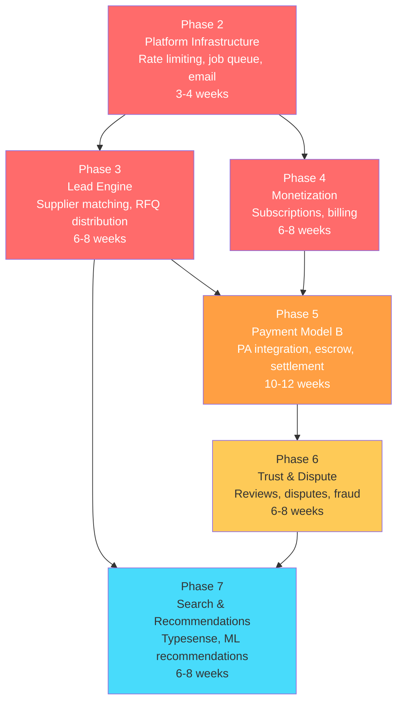

# StoneB2B — Implementation Roadmap
**Classification:** Architecture Audit + Implementation Plan  
**Date:** 2026-11-11  
**Based on:** Evidence-backed audit of `main` at `d694447`

---

## 1. What Is Already Complete

> All items marked ✅ are VERIFIED from source code inspection.

### 1.1 Foundation Layer (Complete)

| Capability | Evidence |
|-----------|---------|
| ✅ Next.js 15.5 App Router monorepo | `apps/web/` — full route structure |
| ✅ Turborepo + pnpm workspace | 7 packages |
| ✅ Supabase SSR auth (cookie-based) | `lib/auth.ts`, `lib/supabase.ts` |
| ✅ Role-based access control | `user_roles` table + DB functions |
| ✅ 4-subdomain middleware routing | `middleware.ts`, `lib/subdomains.ts` |
| ✅ Shared cookie domain for SSO | `packages/database/src/server.ts` |
| ✅ 171 unit tests + 55 E2E tests | `apps/web/tests/` + `e2e/` |
| ✅ 229 database RLS tests | `packages/database/tests/` |
| ✅ 79 Zod validation schema tests | `packages/validation/` |
| ✅ TypeScript strict mode | All packages |

### 1.2 Public Marketplace (Complete)

| Capability | Evidence |
|-----------|---------|
| ✅ Homepage with hero + categories + suppliers | `app/(public)/page.tsx` |
| ✅ Product catalogue with 10+ filters | `app/(public)/products/` |
| ✅ Full-text search | `tsvector` + `textSearch()` |
| ✅ Product detail page | `app/(public)/products/[slug]/` |
| ✅ Category browser (14 categories) | `app/(public)/categories/` |
| ✅ Supplier directory | `app/(public)/suppliers/` |
| ✅ Supplier storefront | `app/(public)/suppliers/[slug]/` |
| ✅ SEO metadata + sitemap + robots | `generateMetadata()` per page |
| ✅ Seed data fallback for pre-DB state | 12 curated products, 4 sellers |
| ✅ Guest RFQ submission | `features/rfq/public-rfq-actions.ts` |

### 1.3 Seller Portal (Complete)

| Capability | Evidence |
|-----------|---------|
| ✅ Seller dashboard | `app/seller/dashboard/` |
| ✅ Product CRUD + image upload | `app/seller/products/` + API route |
| ✅ Brand media upload (logo, cover) | `api/seller/brand-media` |
| ✅ Seller verification flow + document upload | `app/seller/verification/` |
| ✅ Enquiry inbox + status transitions | `app/seller/enquiries/` |
| ✅ Quotation builder with line items | `app/seller/quotes/` |
| ✅ Order management | `app/seller/orders/` |
| ✅ Seller messaging (realtime) | `app/seller/messages/` |
| ✅ Seller analytics page | `app/seller/analytics/` |
| ✅ Store settings | `app/seller/store/` |

### 1.4 Buyer Portal (Complete)

| Capability | Evidence |
|-----------|---------|
| ✅ Buyer dashboard | `app/buyer/dashboard/` |
| ✅ RFQ creation | `app/buyer/rfqs/` |
| ✅ Enquiry management | `app/buyer/enquiries/` |
| ✅ Quotation review + PDF download | `app/buyer/quotations/` + `/api/buyer/quotes/[id]/pdf` |
| ✅ Quotation acceptance → order | `accept_quotation_and_create_order()` RPC |
| ✅ Order tracking | `app/buyer/orders/` |
| ✅ Favourites | `app/buyer/favourites/` |
| ✅ Buyer messaging (realtime) | `app/buyer/messages/` |
| ✅ Address book | `app/buyer/addresses/` |
| ✅ Buyer profile + settings | `app/buyer/profile/` + `/settings/` |

### 1.5 Admin Portal (Complete)

| Capability | Evidence |
|-----------|---------|
| ✅ Admin dashboard with KPIs | `admin_dashboard_metrics()` RPC |
| ✅ Seller verification management | `reviewSellerAction()` |
| ✅ Product moderation queue (single + bulk) | `moderateProductAction()`, `bulkModerateProductsAction()` |
| ✅ User / buyer management | `getAdminBuyers()`, `setAccountStatusAction()` |
| ✅ Category CRUD | `saveCategoryAction()` |
| ✅ Enquiry + quotation monitoring | `getAdminEnquiries()` |
| ✅ Order arbitration | `transitionAdminOrderAction()` |
| ✅ Time-series analytics + charts | `admin_time_series()`, `admin_distribution()` |
| ✅ Audit log | `admin_audit_logs` (immutable) |
| ✅ Platform settings | `platform_settings` table |
| ✅ Admin role delegation | `grantAdminRoleAction()`, `revokeAdminRoleAction()` |

---

## 2. Critical Gaps — Security Blockers

> These must be resolved before production launch.

| # | Gap | Severity | Impact |
|---|-----|---------|--------|
| 1 | No rate limiting on `/api/auth/login` | 🔴 CRITICAL | Credential stuffing / brute-force attacks |
| 2 | No subscription/billing system | 🔴 CRITICAL | Platform generates zero revenue |
| 3 | No Payment Aggregator integration | 🔴 CRITICAL | Orders cannot be paid |
| 4 | No `payment_transactions` table | 🔴 CRITICAL | No financial audit trail |
| 5 | Background email worker has no job queue | 🔴 HIGH | Silent email failures; no retry |
| 6 | No supplier matching engine | 🔴 HIGH | RFQs not reaching relevant sellers |
| 7 | No CSRF protection on API routes | 🟡 MEDIUM | API route abuse potential |
| 8 | Realtime connection limits (Supabase plan) | 🟡 MEDIUM | Cannot scale messaging at high load |

---

## 3. Implementation Phases

### Phase 2 — Platform Infrastructure (Priority: Immediate)

**Goal:** Harden production infrastructure before onboarding real sellers.

| Task | Effort | Priority | Acceptance Criteria |
|------|--------|---------|-------------------|
| Rate limiting on `/api/auth/login` (Upstash Redis or Vercel middleware) | S | 🔴 | Max 5 auth attempts per IP per minute; returns 429 |
| Background job queue (pg-boss in PostgreSQL) | M | 🔴 | Jobs persisted to DB; retry on failure; dead-letter queue |
| Email notification pipeline (enquiry received, quote received, verification status) | M | 🔴 | Transactional emails delivered within 60s of trigger |
| Rate limiting on RFQ + enquiry submission endpoints | S | 🟡 | Max 10 RFQ submissions per user per hour |
| Error monitoring (Sentry) | S | 🟡 | All unhandled exceptions captured with context |
| Staging Supabase project + deployment | M | 🟡 | Staging environment that mirrors production schema |
| Health check expansion (`/api/health` → check DB connectivity) | S | 🟡 | Health endpoint returns DB status |

**Estimated Duration:** 3–4 weeks

---

### Phase 3 — Supplier Matching & Lead Engine

**Goal:** Make RFQs actually reach the right sellers — the core B2B value proposition.

| Task | Effort | Priority | Acceptance Criteria |
|------|--------|---------|-------------------|
| Supplier matching algorithm (category + geography + verification) | L | 🔴 | Each submitted RFQ matched to max N verified sellers in relevant category and geography |
| `rfq_matches` table | S | 🔴 | Stores match results with scoring metadata |
| Lead distribution limits (max leads per RFQ per seller) | M | 🔴 | Sellers receive max 5 matched leads per RFQ |
| Lead inbox in seller portal | M | 🔴 | Seller sees all matched leads, can accept/ignore |
| Lead credit system + `lead_credits` table | L | 🟡 | Sellers have credit balance; responding to lead deducts credit |
| Multi-seller RFQ broadcast | M | 🟡 | One RFQ visible to multiple matched sellers |
| Lead expiry (auto-close stale leads) | S | 🟡 | Leads auto-expire after 7 days without seller response |

**Acceptance Criteria for Phase 3 Completion:**  
- A submitted RFQ from a buyer reaches ≥ 1 verified seller within 60 seconds
- Seller receives email notification with RFQ summary
- Seller can respond from their lead inbox
- Full audit trail in `enquiry_status_history`

**Estimated Duration:** 6–8 weeks

---

### Phase 4 — Monetization & Subscription

**Goal:** Generate recurring platform revenue from sellers.

| Task | Effort | Priority | Acceptance Criteria |
|------|--------|---------|-------------------|
| `subscription_plans` table (Free, Basic, Premium) | S | 🔴 | Plans defined with limits (listings, leads, analytics) |
| `subscriptions` table (seller subscription) | S | 🔴 | Tracks active plan, billing period, status |
| Subscription gating (listing limits, lead limits) | M | 🔴 | Sellers on Free plan capped at N active listings |
| Subscription billing integration (Razorpay Subscriptions) | L | 🔴 | Monthly/annual billing with auto-renewal |
| Seller subscription UI (`seller/subscription/`) | M | 🔴 | Plan selection, payment, upgrade flow |
| Admin subscription management | M | 🟡 | Admin can override subscription, view plan distribution |
| Premium listing feature (boosted placement) | M | 🟡 | Premium sellers' products appear first in catalogue |
| Analytics gating (advanced analytics for Premium) | S | 🟡 | Detailed analytics locked to Premium plan |

**Acceptance Criteria for Phase 4 Completion:**
- Seller can subscribe to a paid plan via Razorpay
- Subscription status persists and auto-renews
- Free tier sellers see listing limit warnings
- Admin dashboard shows subscription revenue metrics

**Estimated Duration:** 6–8 weeks

---

### Phase 5 — Payment Model B Integration

**Goal:** Enable real B2B transactions with escrow-based payment security.

| Task | Effort | Priority | Acceptance Criteria |
|------|--------|---------|-------------------|
| Payment Aggregator selection + RBI compliance review | M | 🔴 | Razorpay or PayU approved by legal/compliance team |
| `payment_transactions` table | S | 🔴 | Tracks every PA transaction with idempotency key |
| Payment initiation (buyer pays for order) | L | 🔴 | Buyer redirected to PA checkout; order enters `processing` on success |
| Payment webhook handler | M | 🔴 | Webhook updates `payment_status`; idempotent processing |
| Escrow hold on payment | L | 🔴 | Funds held in PA escrow until delivery confirmation |
| Fund release to seller (post-delivery) | L | 🔴 | Triggered when order reaches `delivered` and buyer confirms |
| Platform commission deduction | M | 🔴 | Commission % deducted before seller settlement |
| Refund processing | M | 🟡 | Triggered on cancelled orders; refunded to buyer payment method |
| GST on platform fee | M | 🟡 | Platform generates GST invoice for commission |
| Payment reconciliation report | M | 🟡 | Daily reconciliation report for finance team |
| TDS deduction (Indian tax compliance) | M | 🟡 | 1% TDS on seller settlements |

**Acceptance Criteria for Phase 5 Completion:**
- Buyer can pay for a confirmed order via Razorpay
- Payment status reflected in real-time in buyer and seller portals
- Funds released to seller within 24h of delivery confirmation
- All transactions logged in `payment_transactions` with no duplicates
- Reconciliation report generated daily

**Estimated Duration:** 10–12 weeks

---

### Phase 6 — Trust, Reviews & Dispute

**Goal:** Build long-term trust and handle edge cases in B2B transactions.

| Task | Effort | Priority | Acceptance Criteria |
|------|--------|---------|-------------------|
| Buyer reviews on completed orders | M | 🟡 | Buyer can rate seller (1–5 stars) + text review post-delivery |
| `reviews` table | S | 🟡 | Linked to `orders`, one review per order |
| Seller response to review | S | 🟡 | Seller can respond to buyer reviews |
| Review display on storefront | M | 🟡 | Average rating shown on seller storefront and product pages |
| Dispute filing by buyer | M | 🟡 | Buyer can open dispute on delivered order |
| `disputes` table | S | 🟡 | Tracks dispute with evidence, status, admin notes |
| Admin dispute resolution | M | 🟡 | Admin can close dispute, trigger refund or release |
| Fraud detection rules | M | 🟡 | Flag accounts with unusual enquiry/order patterns |
| `fraud_flags` table | S | 🟡 | Per-account suspicious activity record |

**Estimated Duration:** 6–8 weeks

---

### Phase 7 — Recommendations & Search Enhancement

**Goal:** Improve discovery through intelligent recommendations.

| Task | Effort | Priority | Acceptance Criteria |
|------|--------|---------|-------------------|
| "Similar Products" on product detail | M | 🟡 | Shows 4 products from same category + similar material |
| "Other Sellers in Category" on storefront | M | 🟡 | Shows 3 competitors in same location |
| Search suggestions / autocomplete | M | 🟡 | Search bar suggests product names + categories |
| Search engine upgrade (Typesense) | L | 🟡 | Full-text search scales beyond 500K products |
| Buyer personalization (recently viewed) | M | 🔵 | Shows last 10 viewed products |
| Email digest recommendations | M | 🔵 | Weekly email to buyers: new products in their interest categories |

**Estimated Duration:** 6–8 weeks

---

## 4. Implementation Dependency Graph

---

## 5. Technology Debt

| Item | Debt Type | Impact | Recommended Fix |
|------|----------|--------|----------------|
| `lib/db.ts` is 2060 LOC monolithic | Maintainability | High coupling; hard to split | Extract into domain modules: `lib/catalogue.ts`, `lib/orders.ts` |
| `material_type` is free-text in products | Data quality | Inconsistent search results | Migrate to enum or controlled vocabulary |
| No staging environment | Operational | Direct prod deployments are risky | Add `staging` branch + Supabase staging project |
| Worker has no job queue | Reliability | Silent email failures | Add `pg-boss` in Phase 2 |
| No request logging | Observability | No audit of API abuse | Add structured logging (Pino + Vercel Log Drains) |
| `orders` exposed as a View | Schema clarity | Unclear if table or view | Inspect migration SQL to clarify |
| No `search_vector` column management | Search quality | Manual maintenance required | Add trigger-based `tsvector` update on product change |

---

## 6. Acceptance Criteria Summary

| Phase | Go/No-Go Criteria |
|-------|-----------------|
| **Phase 2** | Email delivered within 60s; rate limits active on auth; no uncaught errors in Sentry |
| **Phase 3** | ≥90% of submitted RFQs matched to ≥1 verified seller; email delivered to seller |
| **Phase 4** | Seller can purchase and maintain active subscription; listing limits enforced |
| **Phase 5** | Successful end-to-end payment on staging; zero duplicate payment events; reconciliation report accurate |
| **Phase 6** | Buyer can file dispute; admin can resolve; review visible on storefront |
| **Phase 7** | Search returns results in <200ms for 500K products; recommendations shown on product page |

---

## 7. Recommended First Action Items

> Immediate actions after this audit, in priority order:

1. **[CRITICAL] Add rate limiting to `/api/auth/login`** — 1 day effort, prevents credential attacks
2. **[CRITICAL] Design `subscriptions` and `subscription_plans` tables** — Required before Phase 4
3. **[CRITICAL] Design `payment_transactions` table** — Required before Phase 5; involves legal/compliance review
4. **[HIGH] Set up pg-boss job queue in worker** — Unlocks reliable email delivery
5. **[HIGH] Design supplier matching algorithm** — Core B2B differentiation; requires product/strategy input on matching weights
6. **[MEDIUM] Create staging Supabase project** — Required for safe Phase 3+ development
7. **[MEDIUM] Refactor `lib/db.ts` into domain modules** — Makes Phase 3+ development faster

---

## 8. Estimated Full Roadmap Timeline

| Phase | Weeks | Cumulative |
|-------|-------|-----------|
| Phase 2 — Infrastructure | 3–4 | 3–4 weeks |
| Phase 3 — Lead Engine | 6–8 | 9–12 weeks |
| Phase 4 — Monetization | 6–8 | 15–20 weeks |
| Phase 5 — Payment Model B | 10–12 | 25–32 weeks |
| Phase 6 — Trust & Dispute | 6–8 | 31–40 weeks |
| Phase 7 — Recommendations | 6–8 | 37–48 weeks |

**Full Platform Completion:** Approximately **9–12 months** from this audit date.  
**MVP for first paying sellers:** Phase 2 + Phase 3 completion → approximately **3 months**.

