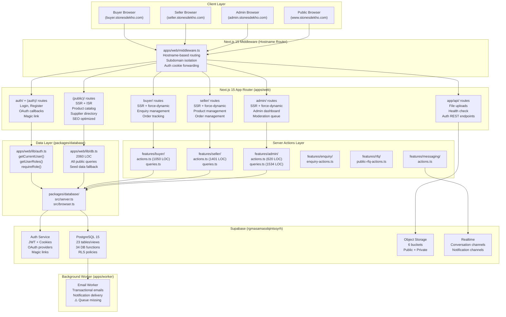
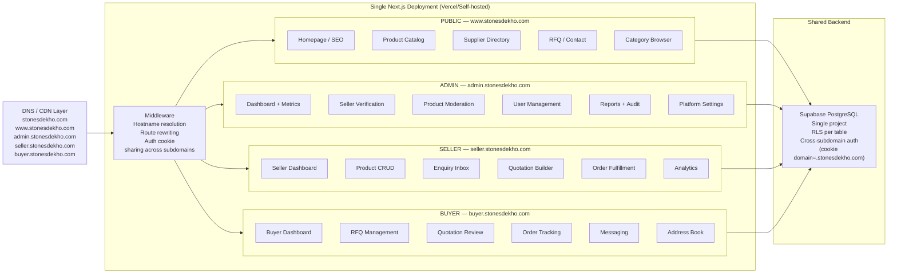
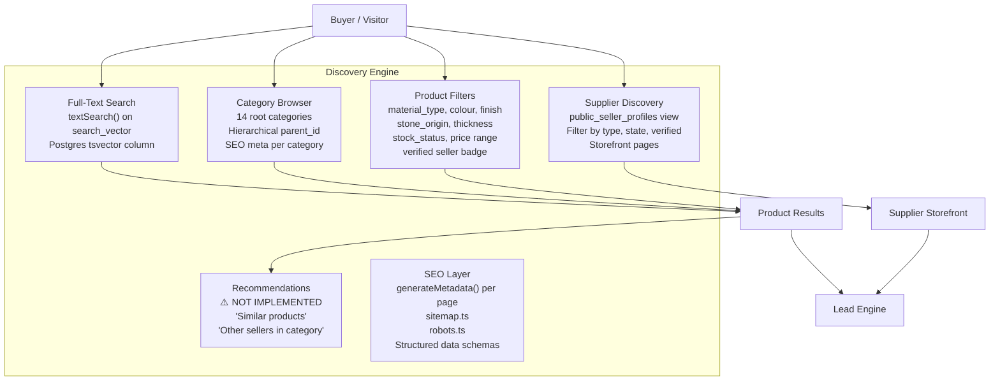
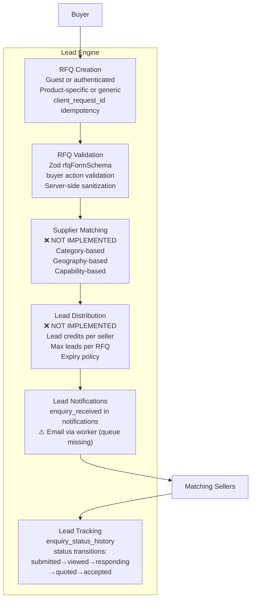
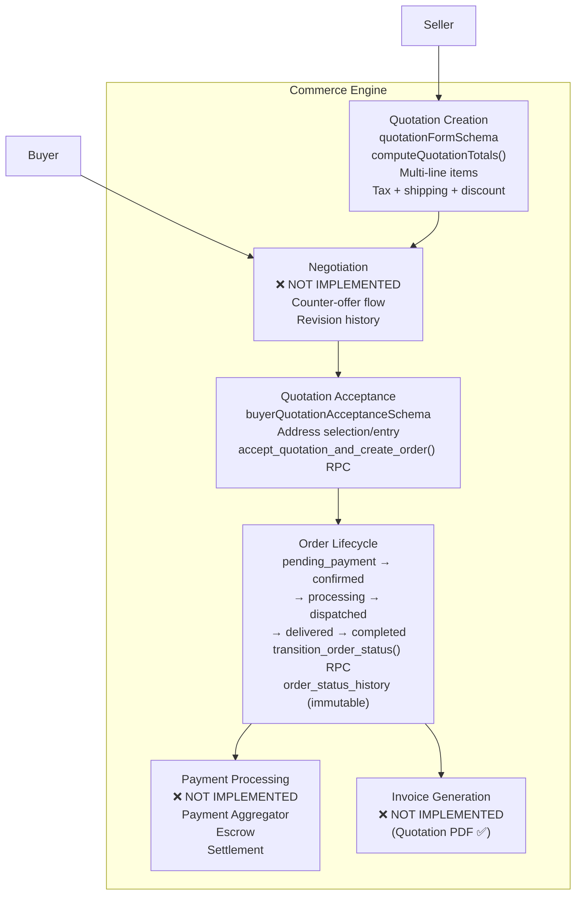
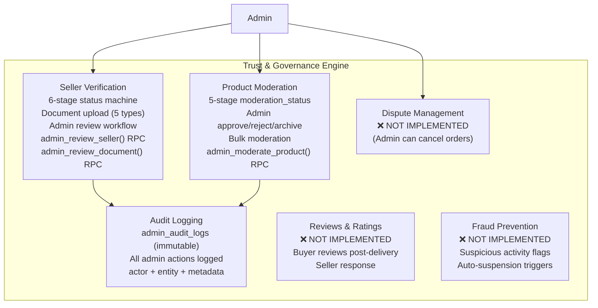
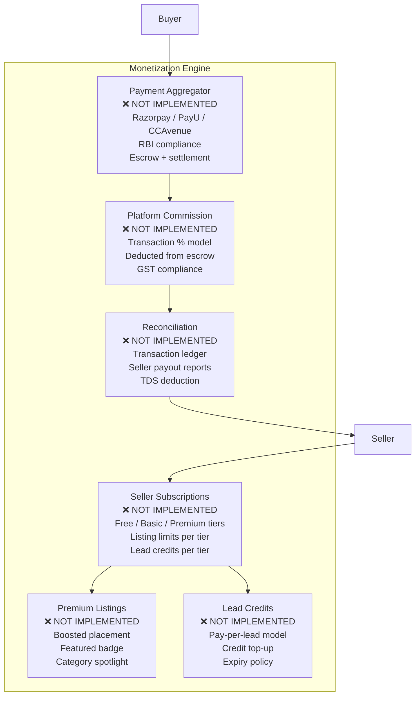
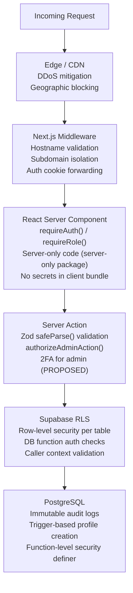
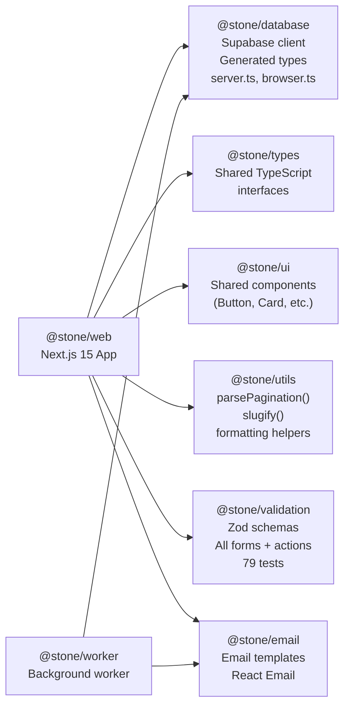

# StoneB2B — System Architecture Blueprint
**Classification:** Read-Only Architecture Audit + Target Design  
**Date:** 2026-11-11  
**Style:** IndiaMART-inspired B2B Marketplace Architecture

---

## 1. High-Level System Architecture



---

## 2. Four-Subdomain Architecture



### 2.1 Subdomain Routing Implementation (VERIFIED)

| Hostname Pattern | Routes To | Implementation |
|-----------------|-----------|---------------|
| `www.{ROOT_DOMAIN}` | Public marketplace | Middleware rewrite → `/(public)/*` |
| `{ROOT_DOMAIN}` | Canonical → Public | Same as www |
| `admin.{ROOT_DOMAIN}` | Admin application | Middleware rewrite → `/admin/*` |
| `seller.{ROOT_DOMAIN}` | Seller application | Middleware rewrite → `/seller/*` |
| `buyer.{ROOT_DOMAIN}` | Buyer application | Middleware rewrite → `/buyer/*` |
| `localhost:3000` | Development — all panels | Path-based routing fallback |
| `*.vercel.app` | Preview deployments | Public marketplace fallback |
| Unknown | 404 controlled error | Safe rejection |

**Cookie Domain:** `.{ROOT_DOMAIN}` — shared across all subdomains for single sign-on  
**Source:** `apps/web/middleware.ts`, `apps/web/lib/subdomains.ts`, `packages/database/src/server.ts`

### 2.2 Monorepo Architecture Evaluation: Unified vs. Multi-App Deployments

| Dimension | Option A: Unified Next.js App + Subdomain Rewrites (Current) | Option B: Multi-App Monorepo (4 Separate Next.js Apps) | Recommendation |
|-----------|-------------------------------------------------------------|---------------------------------------------------------|----------------|
| **Deployment Complexity** | **Low:** Single CI/CD pipeline, single build artifact, 1 deployment target | **High:** 4 concurrent builds, 4 deployment targets, orchestration overhead | **Option A** is far more cost-efficient and faster to iterate |
| **Authentication & SSO** | **Seamless:** Shared cookie domain (`.{ROOT_DOMAIN}`) & shared `@stone/database` server client | **Complex:** Cross-app cookie handling or dedicated OAuth IdP service required | **Option A** eliminates cookie sync issues |
| **Code Sharing** | **Zero-overhead:** Direct imports of components, server actions, and validation schemas | **Medium:** Requires publishing/linking local workspace packages for every shared UI piece | **Option A** prevents package drift |
| **Security & Isolation** | **Enforced in software:** Middleware rewrites + Server Action role guards + RLS policies | **Physical perimeter:** Isolated build outputs; compromising one app cannot access another app's memory | **Option A** is secure when combined with Supabase RLS and Next.js server-only boundaries |
| **Blast Radius** | **Shared:** A deployment error or crash on the unified app affects all portals | **Isolated:** Public marketplace stays up even if the Admin or Seller app crashes | **Option B** has better failure isolation at hyperscale |
| **Build & Bundle Size** | Next.js tree-shakes route groups per entrypoint; static assets segregated | Smaller individual outputs, but Turborepo caches both effectively | Neutral |

**Architectural Verdict:**  
The **Unified Next.js 15 App with Hostname-Based Rewriting (Option A)** is the optimal architectural pattern for StoneB2B's current stage and up to \$50M+ GMV. It allows rapid delivery, atomic database migrations with matching action code, seamless cross-portal session persistence, and shared UI component reuse while preserving strict boundary enforcement through Next.js Middleware and PostgreSQL RLS. A migration to Option B should only be considered if independent engineering squads (>20 engineers) require decoupled release cycles.

---

## 3. Five-Engine IndiaMART-Inspired Architecture

### Engine A: Discovery Engine

**Purpose:** Help global buyers find the right Indian stone product and supplier efficiently.



**Data Ownership:** `categories`, `products`, `product_images`, `product_specifications`, `seller_profiles` (via view)  
**APIs:** `getProducts()`, `getProductDetail()`, `getActiveCategories()`, `getPublicSellers()`  
**Status:** ✅ Core discovery VERIFIED | ❌ Recommendations NOT VERIFIED

---

### Engine B: Lead Engine

**Purpose:** Convert buyer intent into qualified leads delivered to the right sellers.



**Data Ownership:** `enquiries`, `enquiry_status_history`, `notifications`  
**APIs:** `createEnquiryAction()`, `publicRfqAction()`, `transition_enquiry_status()`  
**Critical Gaps:**
- ❌ Supplier matching algorithm
- ❌ Lead credit system
- ❌ Lead distribution limits
- ❌ Bulk RFQ multi-seller dispatch
- ⚠️ Email delivery queue

---

### Engine C: Commerce Engine

**Purpose:** Enable trusted commercial transactions between buyers and sellers.



**Data Ownership:** `quotations`, `quotation_items`, `orders`, `order_items`, `order_status_history`  
**APIs:** `createQuotationAction()`, `acceptQuotationAction()`, `transitionOrderStatusAction()`, `accept_quotation_and_create_order()` RPC

---

### Engine D: Trust & Governance Engine

**Purpose:** Maintain platform integrity through verification, moderation, and dispute management.



**Data Ownership:** `seller_profiles`, `seller_verification_documents`, `products`, `admin_audit_logs`  
**APIs:** `reviewSellerAction()`, `moderateProductAction()`, `bulkModerateProductsAction()`

---

### Engine E: Monetization & Payment Engine

**Purpose:** Generate platform revenue through subscriptions, premium listings, lead credits, and commission.



**Data Ownership:** None yet — `subscriptions`, `subscription_plans`, `payment_transactions` tables are MISSING  
**Status:** ❌ Entire engine NOT IMPLEMENTED

---

## 4. Stone Industry Product Attribute Architecture

### 4.1 Current Product Schema

```
products table:
  material_type   → free-text (should be an enum)
  stone_origin    → free-text (quarry/region)
  colour          → free-text
  finish          → free-text
  thickness       → integer (mm)
  length          → integer (mm)
  width           → integer (mm)
  minimum_order_quantity → integer
  unit            → enum (sq_ft, sq_m, piece, ton, metric_ton, slab, box, custom)
  price_type      → enum (fixed, starting, on_request, negotiable)
```

### 4.2 Recommended Stone Type Attribute Matrix

| Stone Type | Required Attributes | Optional Industry Attributes |
|-----------|--------------------|-----------------------------|
| **Marble** | Quarry origin, colour, finish, thickness, compressive strength, water absorption | Calcium carbonate %, veining pattern, gangsaw vs. wire-saw, resin treatment |
| **Granite** | Quarry origin, colour, finish, thickness, water absorption | Compressive strength MPa, gangsaw size, edge profiles, block weight |
| **Sandstone** | Quarry origin, colour, finish, thickness, compressive strength | Sand grain size, thermal expansion, slip resistance rating |
| **Limestone** | Quarry origin, colour, finish, thickness, water absorption | Fossil content, natural cleft vs. honed, acid resistance |
| **Quartzite** | Quarry origin, colour, finish, Mohs hardness, water absorption | Flexural strength, acid resistance, UV stability |
| **Slate** | Quarry origin, colour, finish, frost resistance | Foliation direction, gauge tolerance, EN 12326 certification |
| **Travertine** | Quarry origin, colour, fill type (unfilled/filled/epoxy), finish | Void percentage, light transmission (for backlit) |
| **Onyx** | Quarry origin, colour, light transmission grade, finish | Mesh backing type, translucency rating |
| **Semi-Precious** | Stone type, origin, colour, inlay technique | Gemstone grade, weight per slab |

### 4.3 Recommended `product_specifications` Standardization

Currently `product_specifications` is a free-form key-value table. For structured search, recommended standardized spec names:

```
Compressive Strength (MPa)
Water Absorption (%)
Density (g/cm³)
Hardness (Mohs)
Flexural Strength (MPa)
Frost Resistance
Slip Resistance (R-value)
Thermal Expansion Coefficient
Light Transmission
Block Dressing Standard
Export Certification (CE, EN 12057, ASTM)
```

### 4.4 Dimensional Tolerances & Quality Grades by Stone Class

| Product Form | Dimension | Standard Commercial Tolerance | Export / Architectural Tolerance |
|--------------|-----------|-------------------------------|----------------------------------|
| **Gangsaw Slabs** | Thickness | ± 1.5 mm to ± 2.0 mm | ± 1.0 mm (Calibrated) |
| **Gangsaw Slabs** | Length & Width | -0 mm / +50 mm | -0 mm / +20 mm |
| **Cut-to-Size Tiles** | Thickness | ± 1.0 mm | ± 0.5 mm |
| **Cut-to-Size Tiles** | Length & Width | ± 1.0 mm | ± 0.5 mm (Diagonal deviation < 1.0 mm) |
| **Monolithic Blocks** | Dressing | 4-Side dressed wire-saw | 6-Side diamond-wire squared (defect marked) |
| **Architectural Carvings (Jaali)** | Thickness | ± 2.0 mm | ± 0.5 mm (5-axis CNC routing tolerance) |

### 4.5 Packaging, Shipping & Export Logistics Specifications

| Parameter | Standard Domestic | Seaworthy Export Standard |
|-----------|-------------------|----------------------------|
| **Crating Material** | Standard untreated wooden pallets | ISPM-15 Heat-Treated & Phytosanitary-Fumigated pinewood |
| **Slab Packaging** | Direct bundle iron strapping | A-Frame steel / heavy timber racks with foam spacers & shrink film |
| **Tile Packaging** | Corrugated cardboard boxes (10 pcs) | Polystyrene padded interior boxes packed inside seaworthy wooden crates |
| **Container Payload** | 20 ft Heavy Duty (27 to 28 Metric Tons) | 20 ft Dry Container max gross weight strictly compliant with port axle laws |
| **Moisture / Desiccant** | Optional | High-grade silica gel bags (2 kg/crate) + VCI anti-condensation sheeting |
| **Transit Breakage Allowance**| 3% to 5% standard B2B threshold | Max 2% with marine cargo transit insurance and photo-lot inspection |

### 4.6 B2B Stone Units of Measurement & Conversion Matrix

The platform must support standardized conversion rates between diverse buyer-seller regional conventions:

- **1 Metric Ton (Granite ~2.9 g/cm³)** $\approx 125$ to $130$ sq. ft. of 20 mm slab
- **1 Metric Ton (Marble ~2.7 g/cm³)** $\approx 135$ to $140$ sq. ft. of 18 mm slab
- **1 Square Metre (sq. m.)** $= 10.7639$ Square Feet (sq. ft.)
- **1 CBM (Cubic Metre)** $\approx 2.7$ Metric Tons (Marble) / $2.9$ Metric Tons (Granite)
- **Minimum Commercial Order (MOQ):** Expressed in square feet (`sq_ft`), square metres (`sq_m`), or metric tons (`metric_ton` for raw quarry blocks).

---

## 5. Scalability Architecture Recommendations

### 5.1 Current Architecture Scalability Assessment

| Dimension | Current State | Scalability Concern |
|-----------|--------------|-------------------|
| Product catalogue | Seed data fallback + live DB | ✅ Scales with indexes |
| Full-text search | `tsvector` on PostgreSQL | ⚠️ Adequate to ~1M products; beyond that → Elasticsearch/Typesense |
| Session handling | Supabase cookie-based SSR | ✅ Stateless — scales horizontally |
| File storage | Supabase Storage | ✅ S3-backed — unlimited |
| Realtime messaging | Supabase Realtime channels | ⚠️ Limited to Supabase plan connection limits |
| Background jobs | No queue | ❌ Not production-ready; needs pg-boss or Redis/BullMQ |
| DB connection pooling | Via Supabase `pgbouncer` | ✅ Built-in |
| Caching | No explicit cache layer | ⚠️ Next.js ISR used; no Redis cache |
| CDN | Via Vercel edge / Supabase Storage CDN | ✅ Adequate |

### 5.2 Recommended Scalability Additions (PROPOSED)

| Addition | Priority | Rationale |
|---------|---------|-----------|
| Redis cache layer for product listings | 🟡 MEDIUM | Reduce DB load on high-traffic catalogue pages |
| Search engine (Typesense / Algolia) | 🟡 MEDIUM | Full-text search beyond 500K products |
| Background job queue (pg-boss) | 🔴 HIGH | Reliable email, notifications, lead distribution |
| Event streaming (Supabase pg_net or webhook) | 🟡 MEDIUM | Trigger downstream services without polling |
| Rate limiting on API routes | 🔴 HIGH | Protect `/api/auth/login` and RFQ submission |
| CDN for product images | ✅ Already handled | Supabase Storage CDN |
| Connection pool upgrade | 🟡 MEDIUM | For seller analytics query load |

---

## 6. Security Architecture

### 6.1 Defence-in-Depth Model



### 6.2 Authentication Architecture

```
Auth Flow:
  1. User submits credentials → /api/auth/login (REST) or Supabase OAuth
  2. Supabase issues JWT → stored in HttpOnly cookie
  3. Cookie domain: .stonesdekho.com (shared across subdomains)
  4. Each Server Component calls getCurrentUser() → supabase.auth.getUser() 
     (validates JWT against Supabase on every request — prevents replay)
  5. Role fetched from user_roles table (not JWT claims)
  6. Access gate: requireRole() → redirect to /unauthorized on failure
  7. Admin actions: authorizeAdminAction() → additional DB-level check
```

---

## 7. Package Architecture



---

## 8. Deployment Architecture (VERIFIED + PROPOSED)

### 8.1 Current (VERIFIED)

```
Turborepo monorepo → pnpm build → Next.js standalone output
Environment: Vercel (inferred from preview deployment handling in middleware)
Supabase: Managed cloud (rgmasamasslqintssyrh)
Domain: Configured via NEXT_PUBLIC_ROOT_DOMAIN env var
```

### 8.2 Recommended Production Architecture (PROPOSED)

```
stonesdekho.com → Vercel Edge Network
  ├── www.stonesdekho.com    → Vercel project (single Next.js app)
  ├── admin.stonesdekho.com  → Same Vercel project (middleware routing)
  ├── seller.stonesdekho.com → Same Vercel project (middleware routing)
  └── buyer.stonesdekho.com  → Same Vercel project (middleware routing)

Supabase:
  ├── Production project (current: rgmasamasslqintssyrh)
  └── Staging project (PROPOSED: separate project for pre-prod testing)

Background Worker:
  └── Vercel Cron / Railway / Fly.io serverless job

Monitoring:
  └── Vercel Analytics + Sentry (PROPOSED)
```

