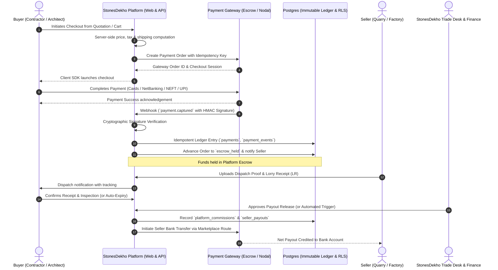
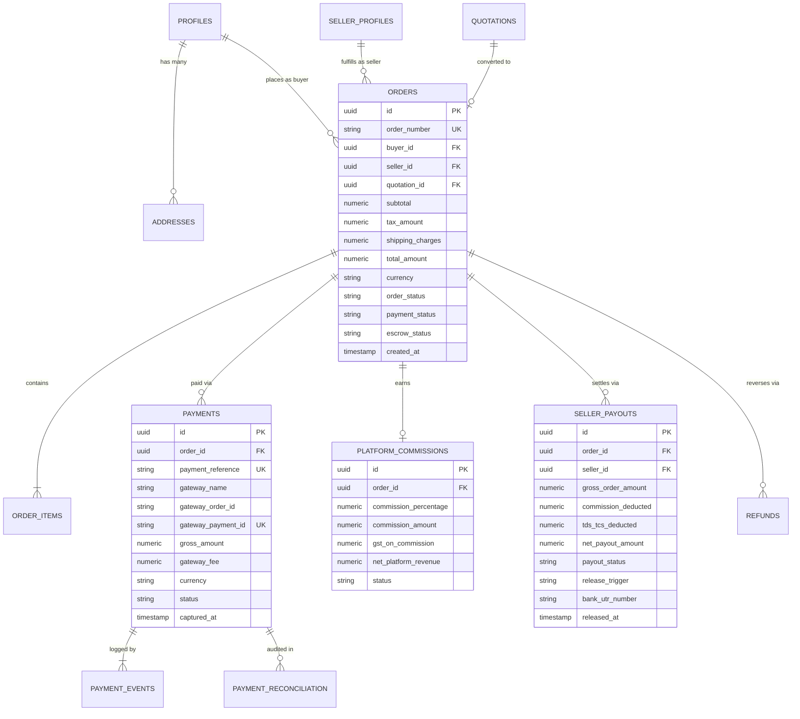
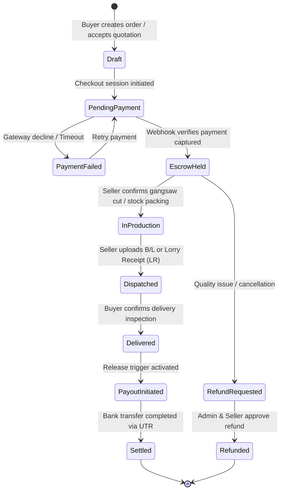

# StonesDekho — Architecture & Implementation Report: Payment Model B
**Payment Flow:** Buyer → StonesDekho Platform (Escrow/Settlement) → Seller Settlement  
**Status:** Architecture Confirmed & Baseline Specification Approved  
**Author:** StonesDekho Core Engineering Team  
**Date:** October 31, 2026  

---

## Executive Summary

Under **Payment Model B**, StonesDekho acts as the central marketplace payment facilitator. Rather than buyers paying stone manufacturers directly, all buyer payments are routed through StonesDekho's secure, integrated payment infrastructure. StonesDekho holds funds in trust (escrow/settlement ledger), computes and deducts platform commissions, tracks regulatory taxes (TDS/TCS/GST), and settles net proceeds to verified stone suppliers upon fulfillment verification.

This report establishes the complete architectural blueprints, database schema additions, security invariant rules, and order lifecycle state machines necessary to implement this model safely, with zero premature gateway coupling and zero hardcoded business variables.

---

## 1. End-to-End Business & Fund Flow



---

## 2. Existing Schema Audit vs Proposed Additions

### 2.1 Existing Database Assets (Current Baseline)
The following tables are currently live and functional in the StonesDekho PostgreSQL database:
- `public.profiles` & `public.user_roles`: RBAC authentication (buyer, seller, admin).
- `public.seller_profiles` & `public.seller_verification_documents`: Supplier onboarding & GST/KYC compliance.
- `public.categories`, `public.products`, `public.product_images`, `public.product_specifications`: Product catalog.
- `public.enquiries`, `public.enquiry_status_history`: B2B direct inquiries and RFQs (supports guest & registered buyers).
- `public.quotations`, `public.quotation_items`: Seller quotations with server-calculated subtotals, taxes, and validity dates.
- `public.platform_settings`: Dynamic key-value configuration store for runtime platform parameters.

### 2.2 New Database Entities Required for Commerce (Additive Only)
The existing schema **does not contain any order or payment tables yet**. The following 8 modular database tables will be introduced in subsequent commerce migrations:

```
┌─────────────────────────────────────────────────────────────────────────────┐
│                              COMMERCE DOMAIN                                │
├──────────────────────────┬──────────────────────────┬───────────────────────┤
│ 1. addresses             │ Standardized delivery &   │ Buyer delivery points │
│                          │ billing locations        │ with GSTIN & pin code │
├──────────────────────────┼──────────────────────────┼───────────────────────┤
│ 2. carts & cart_items    │ Multi-product / sample   │ Active session cart   │
│                          │ shopping basket          │ with live price check │
├──────────────────────────┼──────────────────────────┼───────────────────────┤
│ 3. orders & order_items  │ Durable purchase contracts│ Linked to quotations  │
│                          │ between buyer & seller   │ or standard catalog   │
├──────────────────────────┴──────────────────────────┴───────────────────────┤
│                              FINANCIAL DOMAIN                               │
├──────────────────────────┬──────────────────────────┬───────────────────────┤
│ 4. payments &            │ Inward payments from     │ Gateway order, payment│
│    payment_events        │ buyers & raw webhook logs│ ID, HMAC event hash   │
├──────────────────────────┼──────────────────────────┼───────────────────────┤
│ 5. platform_commissions  │ StonesDekho marketplace  │ Dynamic rate, gross,  │
│                          │ revenue ledger           │ GST on commission     │
├──────────────────────────┼──────────────────────────┼───────────────────────┤
│ 6. seller_payouts        │ Outward settlement to    │ Bank account, net pay,│
│                          │ seller bank accounts     │ release trigger, UTR  │
├──────────────────────────┼──────────────────────────┼───────────────────────┤
│ 7. refunds & refund_items│ Reversals, order damages,│ Explicit financial    │
│                          │ or cancellation credits  │ reversal audit trail  │
├──────────────────────────┼──────────────────────────┼───────────────────────┤
│ 8. payment_reconciliation│ Tripartite settlement    │ Bank vs Gateway vs    │
│                          │ audit & discrepancy flags│ Platform Ledger       │
└──────────────────────────┴──────────────────────────┴───────────────────────┘
```

---

## 3. Detailed Proposed Database Design

### 3.1 Entity Relationship Diagram



---

## 4. The 12 Mandatory Architecture Rules

| # | Architecture Rule | Implementation Invariant |
|---|-------------------|---------------------------|
| **1** | **Order-Payment Binding** | An order cannot transition to `confirmed` or `processing` without an active foreign key to a verified `payments` record with `status = 'captured'`. |
| **2** | **Server-Side Price Authority** | Prices, weights, sq.ft conversions, GST calculations, and transport charges are computed strictly server-side. Form submissions from browsers with modified prices are rejected with `400 Bad Request`. |
| **3** | **Zero Client Financial Trust** | Frontend values for `price`, `tax_rate`, `discount`, `commission`, or `payment_status` are discarded. The database check constraints validate `total = subtotal + tax + shipping - discount`. |
| **4** | **Cryptographic Webhook Verification** | Webhooks from gateways (Razorpay/Stripe/Cashfree) are verified using raw binary payloads and HMAC SHA256 signatures before reading event data. Invalid signatures yield an immediate `401 Unauthorized`. |
| **5** | **Strict Idempotency** | Every webhook event has its unique event ID checked against `payment_events(gateway_event_id)`. Duplicates are acknowledged (`200 OK`) without double-mutating balances or triggers. |
| **6** | **Immutable Financial Ledger** | Tables `payments`, `payment_events`, `platform_commissions`, and `seller_payouts` use a PostgreSQL trigger `prevent_mutation()` preventing `UPDATE` and `DELETE`. Corrections are made via credit/debit adjustment entries only. |
| **7** | **Seller Payable Balances** | Net payable amounts to sellers are tracked per order in `seller_payouts`. Balances remain in `holding_escrow` status until the dispatch/inspection release trigger conditions are satisfied. |
| **8** | **Explicit Refunds & Reversals** | Refunds are never handled by silently subtracting order totals. A discrete `refunds` entry is generated, referencing the original `payment_id`, with explicit reason, gateway reversal reference, and commission reversal logic. |
| **9** | **Tripartite Settlement Reconciliation** | A scheduled job matches `bank_statements` vs `gateway_settlement_files` vs `platform_internal_ledger`. Any discrepancy > ₹0.01 triggers an immediate admin finance alert. |
| **10** | **Server-Only Secret Isolation** | Gateway API Secret Keys, Webhook Secrets, and Payout Tokens are stored in server-side environment variables (`.env.local` / Secret Manager), never prefixed with `NEXT_PUBLIC_`. |
| **11** | **Strict Row-Level Security (RLS)** | Sellers can never query other sellers' commission rates or payouts (`is_seller_owner(seller_id)`). Buyers can only query their own receipts (`buyer_id = auth.uid()`). Trade Desk/Finance have elevated audit access. |
| **12** | **No Optimistic Client Payment Confirmation** | The frontend success redirect URL (`/checkout/success?session_id=...`) only shows a "Verifying payment with bank..." polling spinner. The order status is updated solely by verified server-side webhooks. |

---

## 5. Order & Escrow State Machine



---

## 6. Dynamic Configuration Strategy (Zero Hardcoded Values)

The 5 unfinalized business rules are **intentionally not hardcoded** in SQL migrations or TypeScript source code. They will be managed dynamically via `public.platform_settings`:

| Parameter | Storage Location | Dynamic Behavior |
|-----------|------------------|------------------|
| **Commission Percentage** | `platform_settings.marketplace_commission_pct` | Can vary per seller tier (e.g. 3% for Premier Quarry Owners, 5% for Standard Exporters) or per stone category. |
| **Payout Release Trigger** | `platform_settings.payout_release_trigger` | Configurable options: <br>• `on_dispatch_proof` (LR upload)<br>• `on_buyer_delivery_ack`<br>• `auto_after_x_days` (default 7 days post-dispatch). |
| **Refund & Cancellation Policy** | `platform_settings.cancellation_rules` | Differentiates custom cut-to-size slabs (non-cancellable after gangsaw start) vs standard catalog inventory lots (standard return policy). |
| **GST / Tax Responsibility** | `platform_settings.tax_handling_model` | Dynamically supports TCS under Section 52 of CGST Act (1% TCS deducted by marketplace) and GST invoice issuance (Seller-to-Buyer direct invoice or Principal-to-Principal platform invoice). |
| **Payment Provider Configuration** | Environment Variables & Provider Adapters | Abstracted using a payment provider adapter interface (`PaymentGatewayProvider`), enabling smooth switching between Razorpay Route, Cashfree Marketplace, or Stripe Connect without rewriting business logic. |

---

## 7. Regulatory & Compliance Requirements for India (RBI Guidelines)

Because StonesDekho operates in the high-ticket B2B natural stone sector in India, Model B implementation must adhere to Reserve Bank of India (RBI) marketplace guidelines:

1. **PA/PG Guidelines (Payment Aggregator):**
   - Platforms cannot hold customer funds directly in a standard corporate current account.
   - Funds must flow through an **Escrow Account / Nodal Account** managed by an RBI-authorized Payment Aggregator (e.g., Razorpay Route, Cashfree Marketplace, ICICI/HDFC Nodal Escrow).
2. **Tax Collected at Source (TCS):**
   - Under GST laws (Section 52), an e-commerce operator must collect TCS at 1% (0.5% CGST + 0.5% SGST or 1% IGST) on the net value of taxable supplies made through it by other suppliers.
3. **Invoicing Requirements:**
   - Seller issues Tax Invoice for goods directly to Buyer.
   - Platform issues Tax Invoice for Platform Commission / Convenience Fee (+ 18% GST) to Seller.

---

## 8. Implementation Roadmap & Guardrails

### Phase 1 (Current): Guest Enquiry & RFQ Persistence
- Focus strictly on lead generation and direct buyer-seller inquiry communication.
- No payment gateway code or transaction processing in this phase.

### Phase 2: Quotation Acceptance & Order Initiation
- Create `addresses`, `orders`, and `order_items` tables with database migrations.
- Allow buyers to accept a received quotation to generate a formal binding order contract.

### Phase 3: Payment Provider Selection & Sandbox Integration
- Formalize contract with RBI-compliant B2B marketplace provider (e.g., Razorpay Route).
- Implement `PaymentGatewayProvider` adapter with strict mock/sandbox testing.
- Implement webhook handler with cryptographic verification and idempotency locks.

### Phase 4: Admin Settlement, Escrow Ledger & Payout Automation
- Admin Finance Portal for monitoring escrow balances, release approvals, and reconciliation.
- Multi-party settlement testing with automated TCS calculation.
- Final legal and accounting sign-off before production release.

---

> [!IMPORTANT]
> **Production Safety Commitment:**
> No real financial transactions, live payment gateway credentials, or irreversible production database migrations will be executed without formal business and legal sign-off.

