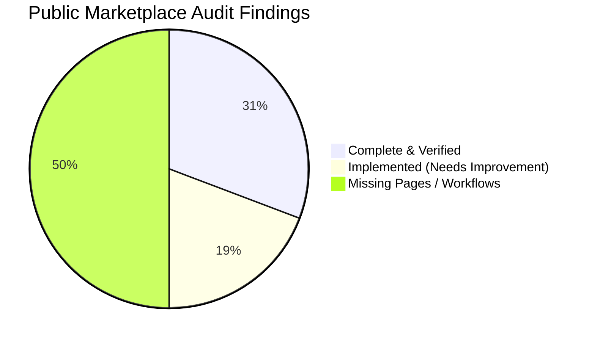

# StoneB2B — Public Website Deep Audit & Gap Analysis

**Document Version:** 1.0.0  
**Audit Date:** October 31, 2026  
**Environment:** Local Development (`http://localhost:3000`) & Supabase PostgreSQL  
**Audit Scope:** Complete Public-Facing Marketplace (Routes, Components, Services, Server Actions, Schema Dependencies)  

---

## 1. Executive Summary & Audit Methodology

This audit provides a factual, code-inspected, and runtime-verified assessment of the public-facing natural stone marketplace for **StoneB2B**.

### Verification Standard
Every claim in this document has been verified against:
1. Actual source files in `apps/web/app/(public)/*`, `components/*`, `lib/*`, and `features/*`.
2. Live HTTP responses from the local development server on `http://localhost:3000`.
3. Supabase migrations (`supabase/migrations/*.sql`) and database schemas.
4. Static analysis via `pnpm typecheck`, `pnpm lint`, and automated test execution.

---

## 2. Route-by-Route Classification & Audit Matrix

Each route has been classified under one of five statuses:
- **Complete & Verified:** Fully functional, connected to data/fallback, error handled, and responsive.
- **Implemented — Requires Improvement:** Route functions, but has missing sub-features, UX gaps, or unhandled edges.
- **Partially Implemented:** Functional in parts, but critical components or integrations are incomplete.
- **Broken:** Throws runtime error, redirects improperly, or breaks user journey.
- **Missing:** Required by B2B stone procurement workflows but not yet implemented.

| Route Path | Type / Purpose | Classification | Primary Findings & Remaining Gaps |
| :--- | :--- | :--- | :--- |
| `/` | Marketplace Homepage | **Implemented — Requires Improvement** | Strong visual hero & products; missing "How StoneB2B Works" section, stone applications showcase, project case studies, and B2B FAQ. |
| `/products` | Products Catalogue | **Implemented — Requires Improvement** | Parametric filters work, but **thickness**, **location/origin**, and **MOQ** filters are missing from UI; **Sort dropdown** is missing; **Mobile filter drawer** is missing (sidebar renders inline on mobile). |
| `/products/[slug]` | Product Details | **Implemented — Requires Improvement** | Gallery, specs table, and quote modal work; but contains a non-functional `StartConversationButton` (Phase 6 messaging) that should be replaced with direct enquiry/quote trigger. |
| `/products/[slug]/enquiry`| Dedicated RFQ Workspace | **Complete & Verified** | Single-product snapshot, BOQ fields, unit selection, and server action insertion into `public.enquiries` verified. |
| `/categories` | Stone Categories Hub | **Complete & Verified** | 14 stone varieties, responsive grid, SEO tags, and fallback data verified. |
| `/categories/[slug]` | Category Detail Page | **Complete & Verified** | Sub-types rendering, category descriptions, and filtered products grid working properly. |
| `/suppliers` | Suppliers Directory | **Complete & Verified** | State filter, business type filter, search, and pagination against `public_seller_profiles` working. |
| `/suppliers/[slug]` | Supplier Storefront | **Implemented — Requires Improvement** | Hero cover, business bio, and Schema.org JSON-LD work; but has non-functional `StartConversationButton` that must point to verified enquiry flow. |
| `/search` | Search Query Router | **Complete & Verified** | Normalizes query parameters and redirects cleanly to `/products?q=...`. |
| `/about` | About & Platform Story | **Complete & Verified** | 3-step trade process, sourcing pillars, and quarry imagery verified. |
| `/contact` | Trade Desk Operations | **Complete & Verified** | RIICO Jaipur address and `submitContactEnquiry` Server Action verified. |
| `/terms` | Legal Terms of Service | **Complete & Verified** | 10-section B2B commercial agreement verified. |
| `/privacy` | Privacy & Compliance | **Complete & Verified** | Row-Level Security, data retention, and cookie disclosure verified. |
| `/how-it-works` | Step-by-Step B2B Workflow | **Missing** | Dedicated page explaining RFQs, inspection, escrow/terms, and port logistics. |
| `/request-quote` | General RFQ Procurement | **Missing** | Dedicated multi-stone/general procurement page for buyers with BOQ upload (not tied to single product). |
| `/faq` | B2B Stone FAQ | **Missing** | High-value B2B procurement, payment, export packaging, and sampling answers. |
| `/supplier-verification` | Trust & Compliance Standards | **Missing** | Explains GSTIN checks, factory audits, and certification criteria for suppliers. |
| `/buyers` | Buyer Sourcing Guide | **Missing** | Guide for architects, builders, and global stone importers. |
| `/sell-on-stoneb2b` | Supplier Onboarding Guide | **Missing** | Guide for Indian quarry owners and factory operators to join the platform. |
| `/applications` | Architectural Applications | **Missing** | Discovery by use-case: Flooring, Cladding, Countertops, Landscaping, Monuments. |
| `/applications/[slug]` | Application Details | **Missing** | Specific technical specifications and stone recommendations for given application. |
| `/locations` | Stone Sourcing Belts | **Missing** | Indian stone geography: Makrana, Dholpur, Kota, Ongole, Udaipur, Madurai. |
| `/locations/[slug]` | Regional Stone Hub Detail | **Missing** | Geological background and prominent stone types for a specific hub. |
| `/projects` | Case Studies & Gallery | **Missing** | Architectural showcase of completed natural stone projects. |
| `/resources` | Technical Guides & Resources | **Missing** | Natural stone care, finish selection, and ASTM/IS stone testing guides. |
| `/not-found` | Branded 404 Error Page | **Missing** | Default unstyled Next.js 404 is currently returned instead of branded StoneB2B 404. |
| `/error` | Public Error Boundary | **Missing** | Root or public error boundary missing; unhandled exceptions trigger default Next.js error overlay. |

---

## 3. Detailed Component & Integration Audit

### 3.1 Public Layout, Header & Footer
- **Source Files:**
  - Layout: [`apps/web/app/(public)/layout.tsx`](file:///Users/vatsalyabhardwaj/Desktop/Website%20Codes%20Zoom%20Digital/Stone_B2B/apps/web/app/(public)/layout.tsx)
  - Header: [`apps/web/components/layout/site-header.tsx`](file:///Users/vatsalyabhardwaj/Desktop/Website%20Codes%20Zoom%20Digital/Stone_B2B/apps/web/components/layout/site-header.tsx)
  - Footer: [`apps/web/components/layout/site-footer.tsx`](file:///Users/vatsalyabhardwaj/Desktop/Website%20Codes%20Zoom%20Digital/Stone_B2B/apps/web/components/layout/site-footer.tsx)
  - Mobile Menu: [`apps/web/components/layout/mobile-nav.tsx`](file:///Users/vatsalyabhardwaj/Desktop/Website%20Codes%20Zoom%20Digital/Stone_B2B/apps/web/components/layout/mobile-nav.tsx)
- **Findings:**
  1. **Layout Isolation:** Fully verified. The public header and footer do not leak into `/buyer/*`, `/seller/*`, or `/admin/*`.
  2. **Header Navigation:**
     - Links currently present: `Home`, `Products`, `Suppliers`, `Categories`.
     - **Missing:** Direct "Request a Quote" / "Post RFQ" CTA in the top navbar.
     - **Desktop Search:** The search button navigates to `/products` directly rather than opening an interactive search palette.
  3. **Footer Navigation Defects:**
     - Link `/sellers/list-products` is broken (triggers middleware redirect to `/login`).
     - Link `/sellers/verification` is misrouted (should be `/supplier-verification` or `/seller/verification`).
     - Link `/careers` returns 404.
     - Link `/buyer/rfqs/new` is a protected buyer route; clicking it unauthenticated redirects to login without public onboarding explanation.

---

### 3.2 Product Catalogue & Search (`/products`)
- **Source Files:**
  - Page: [`apps/web/app/(public)/products/page.tsx`](file:///Users/vatsalyabhardwaj/Desktop/Website%20Codes%20Zoom%20Digital/Stone_B2B/apps/web/app/(public)/products/page.tsx)
  - Filter Sidebar: [`apps/web/components/ui/filter-sidebar.tsx`](file:///Users/vatsalyabhardwaj/Desktop/Website%20Codes%20Zoom%20Digital/Stone_B2B/apps/web/components/ui/filter-sidebar.tsx)
  - Search Bar: [`apps/web/components/ui/search-bar.tsx`](file:///Users/vatsalyabhardwaj/Desktop/Website%20Codes%20Zoom%20Digital/Stone_B2B/apps/web/components/ui/search-bar.tsx)
  - Product Card: [`apps/web/components/ui/product-card.tsx`](file:///Users/vatsalyabhardwaj/Desktop/Website%20Codes%20Zoom%20Digital/Stone_B2B/apps/web/components/ui/product-card.tsx)
- **Findings:**
  1. **Active Filter Functionality:** Categories, Material Types, Colours, Finishes, Price Range (Min/Max), and Verified Sellers toggle all correctly synchronize with URL search parameters and database queries.
  2. **Missing Architectural Filters:**
     - The `public.products` schema supports `thickness` (`numeric(6,2)`), `stone_origin` (`text`), and `minimum_order_quantity` (`numeric(14,3)`), but **none of these are exposed as filter controls in the sidebar**.
  3. **Missing Sort Controls:** There is no `<select>` or dropdown in the UI to allow sorting by Price (Low/High), Newest, or Name, although `lib/db.ts` supports `sort`.
  4. **Mobile Responsiveness Gap:** On screens `< 1024px`, the filter sidebar renders directly above the product grid rather than in an off-canvas mobile drawer with a "Filter & Sort" trigger button.

---

### 3.3 Product Details (`/products/[slug]`)
- **Source File:** [`apps/web/app/(public)/products/[slug]/page.tsx`](file:///Users/vatsalyabhardwaj/Desktop/Website%20Codes%20Zoom%20Digital/Stone_B2B/apps/web/app/(public)/products/[slug]/page.tsx)
- **Findings:**
  1. **Gallery & Specs:** Multi-angle image gallery with thumbnail navigation and laboratory specifications table renders cleanly.
  2. **Quotation Workflow:** Contains an embedded `EnquiryForm` and a button linking to `/buyer/rfqs/new?product=...`.
  3. **Messaging Button Issue:** Renders `<StartConversationButton />` which attempts Phase 6 real-time conversation initialization. Because Phase 6 messaging is deferred, this button must be replaced with a reliable contact/enquiry trigger.
  4. **Image Zoom:** Currently relies on static image scaling; hover zoom on desktop would significantly enhance stone texture inspection for architects.

---

### 3.4 Supplier Discovery (`/suppliers` & `/suppliers/[slug]`)
- **Source Files:**
  - Directory: [`apps/web/app/(public)/suppliers/page.tsx`](file:///Users/vatsalyabhardwaj/Desktop/Website%20Codes%20Zoom%20Digital/Stone_B2B/apps/web/app/(public)/suppliers/page.tsx)
  - Storefront: [`apps/web/app/(public)/suppliers/[slug]/page.tsx`](file:///Users/vatsalyabhardwaj/Desktop/Website%20Codes%20Zoom%20Digital/Stone_B2B/apps/web/app/(public)/suppliers/[slug]/page.tsx)
- **Findings:**
  1. **Security & RLS:** Verified. Queries exclusively consume `public_seller_profiles`, ensuring GST certificate uploads, bank details, and personal phone numbers are never exposed.
  2. **Structured Data:** Injects `Organization` JSON-LD schema with address and logo metadata.
  3. **Storefront Missing Features:** Missing factory machinery indicators (gangsaws, multi-wire cutters, bridge cutters) and manufacturing capacity metrics which are critical for international buyers.

---

### 3.5 RFQ & Enquiry Database Schema Constraints
- **Migration:** `supabase/migrations/20261030100300_commerce.sql`
- **Schema Findings:**
  1. **1-to-1 Relationship:** The `public.enquiries` table requires `seller_id uuid not null`.
  2. **Multi-Supplier Broadcasting Limitation:** The database has **no multi-supplier broadcast junction table** (e.g. `rfq_broadcast_sellers`). An enquiry cannot be broadcast to multiple suppliers simultaneously without architectural schema expansion.
  3. **General RFQ Support:** `product_id` is nullable in `public.enquiries`. A buyer can submit an enquiry for custom stone sourcing directly to a selected verified supplier without specifying an existing catalogue product.

---

## 4. Prioritized Gap Summary for Public Completion

### High Priority (Stages 1–4)
1. Fix broken/misnamed footer links (`/sellers/...` -> `/sell-on-stoneb2b`, `/supplier-verification`).
2. Add "Request a Quote" CTA to the public header navigation.
3. Enhance `/products` with missing architectural filters (Thickness, Stone Origin, MOQ) and Sort selector.
4. Implement mobile filter drawer for `/products`.
5. Replace non-functional `StartConversationButton` on product details and supplier storefronts with reliable enquiry/quote triggers.
6. Create branded `not-found.tsx` (404) and `error.tsx` public error boundary.

### Medium Priority (Stages 5–8)
1. Expand Homepage with missing sections: "How StoneB2B Works", Stone Applications, Case Studies, and B2B FAQ.
2. Build dedicated `/how-it-works` and `/faq` pages.
3. Build dedicated `/request-quote` (General RFQ page with BOQ specifications).
4. Build Buyer Guide (`/buyers`) and Seller Onboarding Guide (`/sell-on-stoneb2b`).
5. Build `/supplier-verification` explaining trust, KYC, and factory compliance.

### Long-Term / Industry Discovery (Stages 9–11)
1. Architectural Applications Hub (`/applications`, `/applications/[slug]`).
2. Regional Sourcing Hubs (`/locations`, `/locations/[slug]`).
3. Projects & Case Studies (`/projects`).
4. Stone Technical Guides (`/resources`, `/resources/[slug]`).

