# StoneB2B — Comprehensive Public Website Audit & Technical Architecture Report

**Document Version:** 1.0.0  
**Target Environment:** Local Development & Staging (`http://localhost:3000`)  
**Production Target:** `https://stoneb2b.com`  
**Git Branch:** `vatsalya`  
**Primary Stack:** Next.js 15.5.28 (App Router), React 19, TypeScript 5, Tailwind CSS, Supabase PostgreSQL  

---

## 1. Executive Summary & Platform Identity

**StoneB2B** is an enterprise-grade Business-to-Business (B2B) digital marketplace engineered specifically for the natural stone, architectural surface, and building materials trade. 

The platform directly bridges **global stone buyers** (importers, architects, builders, interior designers, commercial contractors) with **verified Indian quarry owners, processing factories, and certified export houses** situated in key stone belts (Rajasthan, Gujarat, Andhra Pradesh, Karnataka, Tamil Nadu).

### Core Value Propositions
1. **Quarry & Factory Direct:** Eliminates multi-tier brokers, traders, and unverified middlemen.
2. **Strict Verification:** Every featured supplier undergoes GSTIN validation, quarry lease checks, machinery assessment, and export compliance verification.
3. **Architectural Granularity:** Products are catalogued with lab-grade architectural specifications: stone origin, surface finishes (*polished, honed, flamed, leathered, bush-hammered*), slab thickness (*16mm, 18mm, 20mm, 30mm*), and commercial pricing (*₹/sq ft, ₹/sq m, ₹/ton*).
4. **Seamless RFQ & Messaging Flow:** Buyers can search, bookmark favourites, launch customized Requests for Quotation (RFQs) with Bills of Quantities (BOQ), and initiate real-time discussions directly with manufacturers.

---

## 2. Public Routing Architecture & Isolation

The public marketplace routes are cleanly decoupled from authenticated administrative, buyer, and seller workspaces using Next.js App Router **Route Groups** (`apps/web/app/(public)`).

```mermaid
flowchart TD
    Root["Root Layout (app/layout.tsx)<br/>HTML + Body + Global CSS + Neutral DOM"]
    
    subgraph PublicMarketplace["(public) Route Group"]
        PubLayout["Public Layout ((public)/layout.tsx)<br/>renders SiteHeader + Main + SiteFooter"]
        Home["Home (/)"]
        Products["Products Catalog (/products)"]
        ProductDetail["Product Detail (/products/[slug])"]
        Enquiry["Enquiry Flow (/products/[slug]/enquiry)"]
        Categories["Categories Hub (/categories)"]
        CategoryDetail["Category Detail (/categories/[slug])"]
        Suppliers["Suppliers Directory (/suppliers)"]
        SupplierDetail["Supplier Storefront (/suppliers/[slug])"]
        About["About Us (/about)"]
        Contact["Contact Desk (/contact)"]
        Legal["Terms & Privacy (/terms, /privacy)"]
    end

    subgraph AuthenticatedPortals["Isolated Dashboards"]
        BuyerLayout["Buyer Shell (app/buyer/layout.tsx)<br/>Buyer Workspace Exclusively"]
        SellerLayout["Seller Shell (app/seller/layout.tsx)<br/>Seller Workspace Exclusively"]
        AdminLayout["Admin Shell (app/admin/layout.tsx)<br/>Admin Console Exclusively"]
    end

    Root --> PubLayout
    Root --> BuyerLayout
    Root --> SellerLayout
    Root --> AdminLayout

    PubLayout --> Home
    PubLayout --> Products
    PubLayout --> ProductDetail
    PubLayout --> Enquiry
    PubLayout --> Categories
    PubLayout --> CategoryDetail
    PubLayout --> Suppliers
    PubLayout --> SupplierDetail
    PubLayout --> About
    PubLayout --> Contact
    PubLayout --> Legal
```



### Layout Isolation Guarantees
- **Root Layout (`app/layout.tsx`):** Strictly provides HTML boilerplate, meta viewport, favicon, and Tailwind font styling. **Zero navigation headers or footers are rendered here.**
- **Public Layout (`app/(public)/layout.tsx`):** Dedicated wrapper that injects `<SiteHeader />` at `top: 0` and `<SiteFooter />` at the page bottom.
- **Portal Decoupling:** Authenticated dashboards (`/buyer/*`, `/seller/*`, `/admin/*`) never inherit the public header or footer, eliminating navbar leakage.

---

## 3. Page-by-Page Feature & Functional Analysis

### 3.1 Homepage (`/`)
- **File:** `apps/web/app/(public)/page.tsx`
- **Status:** Complete & Fully Responsive
- **Key Sections:**
  1. **Photographic Hero Section:** High-resolution architectural showroom background image (`/images/hero/marble-showroom-hero.jpg`) with dark gradient scrim for contrast, live global search input, and quick CTA buttons (*"Explore Slabs & Tiles"* and *"List Your Factory"*).
  2. **Hero Feature Card:** Interactive lot showcase highlighting *Makrana Pure White Marble Slabs* (₹650/sq ft, 18mm Gangsaw Slabs) with quick-preview thumbnails for Black Galaxy Granite, Dholpur Beige Sandstone, Rajasthan Green Marble, and Classic Travertine.
  3. **Trust Indicators:** Live badges highlighting 100% Verified Indian Factories, Factory-Direct Wholesale Pricing, and Global Port Container Dispatch.
  4. **Featured Categories Grid:** Responsive grid (2/3/4 columns) rendering dynamic categories with photographic thumbnails and hover transitions.
  5. **Popular Stone Products Showcase:** 6 top-rated approved stone lots featuring image preview, material type, color, finish, wholesale pricing, and supplier link.
  6. **Why Choose StoneB2B:** 4 architectural value pillars: Factory Verification, Factory-Direct Pricing, Technical Architectural Specs, and Seaworthy Packaging Logistics.
  7. **Verified Suppliers Directory:** 4 featured certified stone exporters from Rajasthan, Gujarat, Andhra Pradesh, and Karnataka.
  8. **Procurement Call-to-Action:** High-contrast dark banner for custom cut-to-size BOQ requirements and factory partnerships.

---

### 3.2 Products Catalogue (`/products`)
- **File:** `apps/web/app/(public)/products/page.tsx`
- **Status:** Complete & Parameter-Driven
- **URL Parameters Supported:** `q`, `category`, `material`, `colour`, `finish`, `minPrice`, `maxPrice`, `verified`, `sort`, `page`
- **Key Capabilities:**
  - **Dynamic Parametric Filtering:**
    - **Materials:** Marble, Granite, Sandstone, Limestone, Quartzite, Slate, Travertine, Onyx.
    - **Colors:** White, Black, Beige/Cream, Grey, Brown, Green, Red/Pink, Yellow/Gold.
    - **Surface Finishes:** Polished, Honed, Flamed, Leathered, Bush Hammered, Sandblasted, Natural Cleft.
    - **Price Range:** Min/Max range validation in INR.
    - **Verification Toggle:** Filter products exclusively from verified suppliers.
  - **Server-Side Pagination:** 18 products per page with smart URL page synchronization.
  - **Sorting Options:** Newest arrivals, price low-to-high, price high-to-low, and alphabetically.
  - **Product Cards:** Display primary image, stone variety, material type, finish tag, unit pricing (`₹ / sq ft`, `₹ / sq m`, `₹ / ton`), origin location, supplier badge, and quick bookmarking button.

---

### 3.3 Product Detail Page (`/products/[slug]`)
- **File:** `apps/web/app/(public)/products/[slug]/page.tsx`
- **Status:** Complete, SEO-Optimized & Interactive
- **Key Capabilities:**
  - **Multi-Angle Gallery:** Primary image display with full thumbnail gallery (`/images/product-gallery/*`), supporting crystalline veining macros and architectural installation views.
  - **Architectural Specifications Table:** Granular data attributes including:
    - Material Type & Stone Geology
    - Quarry Origin (e.g., *Makrana, Rajasthan*, *Ongole, Andhra Pradesh*)
    - Thickness (*16mm, 18mm, 20mm, 30mm Gangsaw*)
    - Available Finishes (*Polished, Honed, Flamed, Antique*)
    - Minimum Order Quantity (MOQ)
    - Packaging Details (*Seaworthy fumigated wooden crates*)
  - **Interactive Actions:**
    - **Favourite Button:** Real-time sync with Buyer Portal saved items.
    - **Direct RFQ Form:** Quick quotation modal calculating requested square footage and delivery terms.
    - **Direct Supplier Chat:** "Start Conversation" button triggering Phase 5 messaging thread with the verified supplier.
  - **Dynamic Metadata & OpenGraph:** Custom title, description, and preview image dynamically generated from database attributes.
  - **Related Stone Lots:** Intelligently fetches 3 related stone products within the same geology or category.

---

### 3.4 Product Enquiry Flow (`/products/[slug]/enquiry`)
- **File:** `apps/web/app/(public)/products/[slug]/enquiry/page.tsx`
- **Status:** Complete with Server Action Validation
- **Key Capabilities:**
  - Single-product dedicated RFQ workspace.
  - Displays product snapshot card, supplier verification badge, and factory origin.
  - Form fields: Desired quantity (sq ft/sq m/tons), required thickness, finish selection, delivery destination port/city, target delivery date, and technical project remarks.
  - Server Action submission creates a trackable buyer enquiry in Supabase and routes into the Buyer Portal enquiry management center.

---

### 3.5 Categories Hub & Category Detail (`/categories` & `/categories/[slug]`)
- **Files:**
  - `apps/web/app/(public)/categories/page.tsx`
  - `apps/web/app/(public)/categories/[slug]/page.tsx`
- **Status:** Complete
- **Supported Categories (14):**
  1. *Marble* (`/categories/marble`)
  2. *Granite* (`/categories/granite`)
  3. *Sandstone* (`/categories/sandstone`)
  4. *Limestone* (`/categories/limestone`)
  5. *Quartzite* (`/categories/quartzite`)
  6. *Slate* (`/categories/slate`)
  7. *Travertine* (`/categories/travertine`)
  8. *Onyx* (`/categories/onyx`)
  9. *Semi-Precious Stones* (`/categories/semi-precious-stones`)
  10. *Natural Stone Slabs* (`/categories/natural-stone-slabs`)
  11. *Stone Tiles* (`/categories/stone-tiles`)
  12. *Stone Blocks* (`/categories/stone-blocks`)
  13. *Decorative Stone* (`/categories/decorative-stone`)
  14. *Custom Stone Products* (`/categories/custom-stone-products`)
- **Category Detail Features:** Shows geological description, child subcategories/formats, current approved inventory count, and a direct filtered product grid.

---

### 3.6 Suppliers Directory & Storefront (`/suppliers` & `/suppliers/[slug]`)
- **Files:**
  - `apps/web/app/(public)/suppliers/page.tsx`
  - `apps/web/app/(public)/suppliers/[slug]/page.tsx`
- **Status:** Complete with Schema.org JSON-LD
- **Directory Filtering:** Filter verified suppliers by keyword search, business type (*Manufacturer, Exporter, Quarry Owner, Processor, Wholesaler*), and major stone state (*Rajasthan, Gujarat, Andhra Pradesh, Karnataka, Tamil Nadu, Telangana, Madhya Pradesh, Maharashtra*).
- **Supplier Storefront:**
  - Factory Hero Banner & Verified Logo avatar.
  - Company Overview, factory location, years in business, and verification timestamp.
  - **Schema.org Structured Data:** Injects `Organization` JSON-LD schema for rich Google search indexing.
  - Active stone catalog listed exclusively by that supplier.
  - Direct *"Contact Supplier"* messaging trigger.

---

### 3.7 Corporate & Legal Pages
- **About Us (`/about`):** Detailed three-step trade methodology, quarry-to-port transparency, mission statement, and value propositions.
- **Contact Desk (`/contact`):** Headquarters address at RIICO Industrial Area, Stone Park, Jaipur, support email addresses, and an interactive contact form with Server Action validation (`submitContactEnquiry`).
- **Terms of Service (`/terms`):** Comprehensive 10-section B2B commercial agreement covering platform eligibility, listing standards, KYC compliance, dispute resolution, and limitation of liability.
- **Privacy Policy (`/privacy`):** Enterprise data governance policy detailing encryption at rest, Row-Level Security, cookie standards, and data protection rights.
- **Search Redirector (`/search`):** URL normalization utility redirecting keyword queries to `/products?q=...`.

---

## 4. Design System & Visual Architecture

The public marketplace adheres strictly to the approved **Warm Architectural Stone** design tokens:

| Element | Token / Palette | Application |
| :--- | :--- | :--- |
| **Canvas Background** | `bg-stone-50` / `bg-white` | Page wrapper, clean gallery backgrounds |
| **Dark Containers** | `bg-stone-900` / `bg-stone-950` | Hero section, procurement banner, SiteFooter |
| **Borders & Dividers** | `border-stone-200/80` | Cards, input fields, subtle separators |
| **Primary Accents** | `amber-600` / `amber-700` | CTA buttons, active filters, brand highlight |
| **Verified Trust** | `emerald-500` / `emerald-600` | Verified exporter badge, GST validation pills |
| **Typography** | `font-sans` (Inter/System) | Clean architectural readability across all densities |
| **Border Radii** | `rounded-xl` (12px), `rounded-2xl` (16px) | Modern soft geometric containers |

---

## 5. Data Architecture & Resilience Strategy

The public data access layer (`apps/web/lib/db.ts`) is architected around **resilience and security**:

1. **Row-Level Security (RLS) Safety:**
   - Public queries never query private tables (`seller_profiles`) directly.
   - All supplier discovery uses the `public_seller_profiles` database view, ensuring bank details, GST certificate documents, and internal contact information are strictly guarded.
2. **Dual-Mode Graceful Fallbacks:**
   - When connecting to a newly initialized Supabase instance with zero listings, the application does not render broken empty screens.
   - It gracefully serves a curated fallback catalog of **12 high-demand Indian stone varieties** and **4 certified Indian suppliers** with high-resolution photographic imagery.
3. **Storage URL Resolution:**
   - Storage URLs are automatically resolved via `resolveStorageUrl()` for local and Supabase S3 buckets (`product-images`, `seller-logos`, `seller-cover-images`, `category-images`).

---

## 6. SEO, Performance & Security Audit

| Domain | Implementation | Verification Status |
| :--- | :--- | :--- |
| **SEO Metadata** | Unique Title & Description on all 11 routes | ✅ Fully Verified |
| **OpenGraph Cards** | `og:title`, `og:description`, `og:image` | ✅ Configured |
| **Dynamic Sitemap** | `apps/web/app/sitemap.ts` auto-indexes products & categories | ✅ Verified |
| **Robots Policy** | `apps/web/app/robots.ts` disallows `/admin/`, `/buyer/`, `/seller/`, `/api/` | ✅ Verified |
| **Structured Data** | `application/ld+json` Organization schema on `/suppliers/[slug]` | ✅ Verified |
| **Content Security** | Strict CSP headers permit Google Fonts, Supabase endpoints | ✅ Verified (200 OK) |
| **Input Sanitization** | `sanitizeNextPath` & Zod schema parsing on all forms | ✅ Verified |
| **Favicon & Icons** | Binary `favicon.ico` + SVG icon delivered cleanly | ✅ Verified (200 OK) |

---

## 7. Quality Gate & Production Verification

All monorepo quality gates have been executed and verified on branch `vatsalya`:

- **Unit & Integration Tests:**
  ```text
  Test Files  6 passed (6)
  Tests       69 passed (69)  (apps/web)
  Total Monorepo Tests: 318 passed (21 test files)
  ```
- **TypeScript Typecheck:**
  ```text
  turbo run typecheck
  Tasks: 8 successful, 8 total (0 errors)
  ```
- **ESLint Code Quality:**
  ```text
  turbo run lint
  Tasks: 8 successful, 8 total (0 errors, 0 warnings)
  ```
- **Production Build (`pnpm build`):**
  ```text
  Creating an optimized production build ...
  ✓ Compiled successfully in 12.8s
  ✓ Generating static pages (57/57)
  Tasks: 2 successful, 2 total
  ```

---

## 8. Complete Public Website URL Directory

Use the following table to test and review all active public marketplace endpoints:

| Page Name | Local Development URL | Purpose |
| :--- | :--- | :--- |
| **Homepage** | [http://localhost:3000](http://localhost:3000) | Main marketplace hero, search, categories & featured lots |
| **Products Catalog** | [http://localhost:3000/products](http://localhost:3000/products) | Parametric search & filter for slabs and tiles |
| **Product Detail** | [http://localhost:3000/products/makrana-white-marble](http://localhost:3000/products/makrana-white-marble) | Slabs gallery, architectural specs & quote triggers |
| **Product Enquiry** | [http://localhost:3000/products/makrana-white-marble/enquiry](http://localhost:3000/products/makrana-white-marble/enquiry) | Dedicated RFQ BOQ submission page |
| **Categories Hub** | [http://localhost:3000/categories](http://localhost:3000/categories) | All 14 natural stone varieties |
| **Category Detail** | [http://localhost:3000/categories/marble](http://localhost:3000/categories/marble) | Specific stone classification and sub-types |
| **Suppliers Directory** | [http://localhost:3000/suppliers](http://localhost:3000/suppliers) | Directory of certified Indian factories |
| **Supplier Storefront**| [http://localhost:3000/suppliers/shree-ram-marbles](http://localhost:3000/suppliers/shree-ram-marbles) | Factory profile, credentials & inventory |
| **About Us** | [http://localhost:3000/about](http://localhost:3000/about) | Trade process, sourcing standards & platform story |
| **Contact Desk** | [http://localhost:3000/contact](http://localhost:3000/contact) | RIICO Jaipur trade desk & inquiry form |
| **Terms of Service** | [http://localhost:3000/terms](http://localhost:3000/terms) | B2B commercial terms and dispute resolution |
| **Privacy Policy** | [http://localhost:3000/privacy](http://localhost:3000/privacy) | Data protection and encryption standards |

