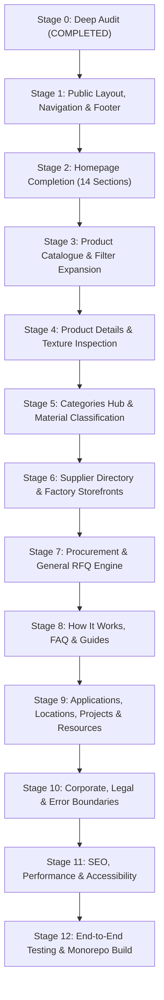

# StoneB2B — Public Website Staged Implementation Plan

**Document Version:** 1.0.0  
**Target Completion:** 100% Production-Ready Public Marketplace  
**Execution Strategy:** Sequential, Staged Implementation with Per-Stage Verification & Zero Regressions  

---

## 1. Plan Overview & Guiding Rules

This plan outlines the sequential roadmap to transform the StoneB2B public marketplace into a complete, professional, B2B procurement platform.

### Strict Execution Constraints
- **Preserve Figma Design Direction:** Warm architectural stone palette (Stone-50/100/900 + Amber-600 accents + Emerald-500 trust badges).
- **Zero Portal Regressions:** Do not touch Buyer, Seller, or Admin portal logic or layouts.
- **No Duplicate Tables or Fake Data:** Rely strictly on existing database tables, views, and genuine stone industry specifications.
- **Stage-by-Stage Verification:** Complete each stage, verify via tests/build, and confirm before advancing.

---

## 2. Staged Implementation Roadmap

---

### Stage 1: Public Layout, Navigation and Footer
**Objective:** Harden the global public shell, fix broken footer links, add prominent RFQ CTAs, and ensure seamless desktop/mobile navigation.

- **Tasks:**
  1. **Update `apps/web/components/layout/site-header.tsx`:**
     - Add a prominent primary CTA button: **"Request a Quote"** (`/request-quote` or general RFQ flow).
     - Add navigation links: `Products`, `Suppliers`, `Categories`, `How It Works`.
     - Improve search trigger for desktop.
  2. **Update `apps/web/components/layout/site-footer.tsx`:**
     - Fix broken link `/sellers/list-products` -> `/sell-on-stoneb2b`.
     - Fix `/sellers/verification` -> `/supplier-verification`.
     - Remove dead `/careers` link or redirect to `/about`.
     - Add links to `How It Works`, `Request a Quote`, `FAQ`, and `Sourcing Locations`.
  3. **Harden `apps/web/components/layout/mobile-nav.tsx`:**
     - Ensure all public pages and procurement links are directly accessible on mobile drawers.
- **Verification:** Unit tests for header and footer; verify all links lead to valid HTTP 200 routes.

---

### Stage 2: Homepage Completion (14 Architectural Sections)
**Objective:** Expand the homepage from 8 partial sections into a complete 14-section B2B natural stone marketplace experience.

- **Sections to Implement / Upgrade in `apps/web/app/(public)/page.tsx`:**
  1. *Public Header & Nav* (Integrated from Stage 1)
  2. *Premium Hero Section* (Refined copy, stone search, Lot card)
  3. *Smart Stone Search Bar* (Full-text query routing)
  4. *Stone Categories Grid* (14 varieties with badges)
  5. *Featured Products Showcase* (Approved stone lots with pricing)
  6. **[NEW] How StoneB2B Works** (4-step visual B2B trade flow: Sourcing, Sample Inspection, RFQ & Verification, Port Dispatch)
  7. *Why Buy Through StoneB2B* (Factory direct, seaworthy packaging, specs)
  8. **[NEW] Stone Applications Showcase** (Flooring, Exterior Cladding, Countertops, Landscaping, Monumental Carvings)
  9. *Verified Suppliers Directory* (Factory credentials, state origin)
  10. **[NEW] Featured Projects / Case Studies** (Architectural installations: airports, luxury villas, hospitality)
  11. *Custom Bulk RFQ Procurement Banner* (BOQ submission CTA)
  12. **[NEW] B2B Procurement FAQ** (Interactive accordion answering shipping, sampling, payment terms, and minimum orders)
  13. *Supplier Registration CTA* (Direct factory onboarding funnel)
  14. *Complete Footer* (From Stage 1)
- **Verification:** Responsive testing across 360px, 768px, 1024px, 1440px; zero layout shifts.

---

### Stage 3: Product Catalogue & Parametric Search Expansion
**Objective:** Equip `/products` with missing architectural specifications, sorting, and mobile drawer filtering.

- **Tasks:**
  1. **Expand `apps/web/components/ui/filter-sidebar.tsx`:**
     - Add **Thickness filter** (`16mm`, `18mm`, `20mm`, `30mm`, `Custom`).
     - Add **Stone Origin / Region filter** (`Makrana`, `Dholpur`, `Kota`, `Ongole`, `Udaipur`, `South India`).
     - Add **Minimum Order Quantity (MOQ) filter**.
  2. **Add Sort Dropdown to `apps/web/app/(public)/products/page.tsx`:**
     - Sort by: *Newest Arrivals*, *Price: Low to High*, *Price: High to Low*, *Material Name (A–Z)*.
  3. **Build Mobile Filter Drawer:**
     - Implement off-canvas slide-over drawer triggered by a sticky "Filters & Sort" button on mobile viewports.
  4. **Update `apps/web/lib/db.ts`:**
     - Ensure SQL queries properly filter on `thickness` and `stone_origin` columns in `public.products`.
- **Verification:** Test multi-filter combinations, URL query synchronization, and empty results state.

---

### Stage 4: Product Detail Page & Texture Inspection
**Objective:** Refine product presentation, replace deferred messaging triggers, and add interactive quotation tools.

- **Tasks:**
  1. **Replace `StartConversationButton`:**
     - Replace the Phase 6 messaging button with a direct **"Contact Supplier"** button that smoothly scrolls to the factory quotation form or opens the single-product enquiry flow.
  2. **Texture Zoom / Inspection:**
     - Implement high-res lightbox / hover zoom on primary slab images to allow architects to inspect veining and crystalline structure.
  3. **Specification Table Polish:**
     - Ensure all technical properties (ASTM/IS standards, water absorption, compressive strength) render with clear units.
- **Verification:** Test quotation submission and verify record in `public.enquiries`.

---

### Stage 5: Categories Hub & Material Classification
**Objective:** Provide detailed geological and architectural classification for all 14 stone varieties.

- **Tasks:**
  1. **Enhance `/categories` and `/categories/[slug]`:**
     - Provide material characteristics, standard density, geological origins, and recommended finishes for each category.
     - Add sub-format filters (e.g. Slabs vs Tiles vs Blocks).
- **Verification:** Check all 14 category routes return HTTP 200 with dynamic metadata.

---

### Stage 6: Supplier Directory & Factory Storefronts
**Objective:** Showcase Indian stone manufacturing capabilities with trust and transparency.

- **Tasks:**
  1. **Enhance `/suppliers` Directory:**
     - Add filter for supplier manufacturing capabilities (*Gangsaw Units, Multi-Wire, Bridge Saw, CNC Polishers*).
  2. **Enhance `/suppliers/[slug]` Storefront:**
     - Add "Direct Factory Enquiry" modal allowing buyers to request custom quotations from the factory.
     - Replace `StartConversationButton` with supported enquiry trigger.
- **Verification:** Confirm RLS compliance (zero exposure of private seller data).

---

### Stage 7: Procurement & General RFQ Engine
**Objective:** Enable global buyers to submit general stone procurement requests with BOQ specifications without being locked into a single product.

- **Tasks:**
  1. **Build `apps/web/app/(public)/request-quote/page.tsx`:**
     - Create dedicated General RFQ form.
     - Fields: Stone variety requested, application type, required quantity & unit, target thickness, finish, destination port/city, target delivery timeline, and project description.
     - Server Action to record inquiry under the selected verified supplier or marketplace trade desk.
- **Verification:** Test submission with valid and invalid inputs; verify buyer notification.

---

### Stage 8: How It Works, FAQ, Buyer & Seller Guides
**Objective:** Provide essential business information and educational material for counterparties.

- **Pages to Build:**
  1. `/how-it-works`: Step-by-step visual guide to sourcing, sample requests, commercial quotes, and container shipping.
  2. `/faq`: Comprehensive searchable Q&A covering logistics, quality assurance, escrow, and export paperwork.
  3. `/buyers`: Sourcing guide specifically tailored for global architects, interior designers, and construction firms.
  4. `/sell-on-stoneb2b`: Complete onboarding guide for quarry owners and processing factories.
  5. `/supplier-verification`: Transparent breakdown of GST verification, factory machinery audits, and quality standards.
- **Verification:** Responsive verification, internal linking, and SEO metadata checks.

---

### Stage 9: Industry Discovery (Applications, Locations, Projects, Resources)
**Objective:** Establish StoneB2B as the authoritative domain reference for natural stone sourcing in India.

- **Pages to Build:**
  1. `/applications` & `/applications/[slug]`: Stone discovery by architectural usage (Flooring, Wall Cladding, Countertops, Landscaping, Monumental Carvings).
  2. `/locations` & `/locations/[slug]`: Geographic hubs of Indian stone (Makrana, Dholpur, Kota, Ongole, Madurai, Jalore).
  3. `/projects`: Architectural showcase of residential and commercial natural stone projects.
  4. `/resources` & `/resources/[slug]`: Natural stone care, finish selection guides, and technical specifications.
- **Verification:** Confirm all dynamic routes render useful, non-empty content with proper metadata.

---

### Stage 10: Corporate, Legal & Error Boundaries
**Objective:** Production-harden legal pages and build branded error handlers.

- **Tasks:**
  1. **Build `apps/web/app/not-found.tsx`:**
     - Branded 404 page with stone styling, search bar, and direct links back to Catalogue and Categories.
  2. **Build `apps/web/app/(public)/error.tsx`:**
     - Public error boundary displaying a user-friendly error card with a retry button.
  3. **Cookie Disclosure / Policy:**
     - Add cookie disclosure modal / banner matching local session standards.
- **Verification:** Test 404 triggering on invalid paths; test error boundary.

---

### Stage 11: SEO, Performance & Accessibility
**Objective:** Audit and optimize search engine visibility, page speed, and WCAG accessibility.

- **Tasks:**
  1. Update `sitemap.ts` to include all new static and dynamic routes.
  2. Audit all images for responsive `sizes` attributes and `alt` tags.
  3. Ensure contrast ratios meet WCAG AA standards.
  4. Add Schema.org BreadcrumbList and WebSite search potentialAction.
- **Verification:** Verify sitemap generation and run Lighthouse audit simulation.

---

### Stage 12: End-to-End Testing & Monorepo Quality Gates
**Objective:** Final validation across the entire monorepo before delivery.

- **Tasks:**
  1. Execute full user journey tests:
     - Public -> Search -> Filter -> Product Detail -> Submit Enquiry.
     - Public -> Suppliers -> Storefront -> Direct Enquiry.
     - Public -> General RFQ -> Confirmation.
  2. Run quality gates:
     - `pnpm lint`
     - `pnpm typecheck`
     - `pnpm test`
     - `pnpm build`
  3. Generate final delivery documentation in `docs/public-website-completion-report.md`.

